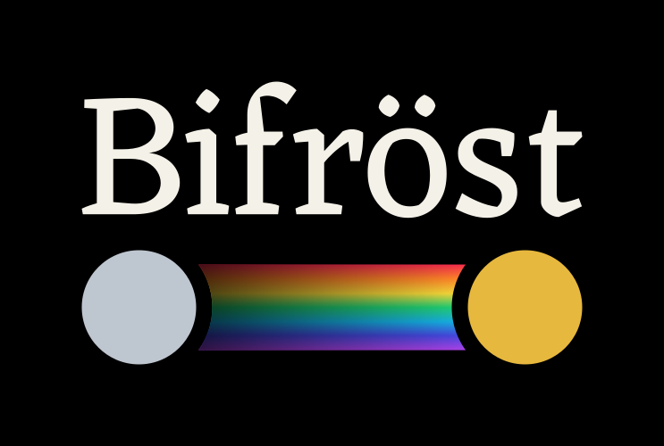

<p align="center"></p>

# bifrost

[](https://sephiram591.github.io/bifrost/)
[](https://github.com/Sephiram591/bifrost/actions/workflows/test.yml)

The rainbow bridge between your GDSFactory(X) pipeline and FDTD(X) simulation.

bifrost turns a [gdsfactory](https://gdsfactory.github.io/gdsfactory/) component and its `LayerStack` into a
differentiable [fdtdx](https://github.com/ymahlau/fdtdx) simulation, and ships a 3D/field viewer. It builds on
[gdsfactoryx](https://github.com/Sephiram591/gdsfactoryx), the JAX port of gdsfactory.

**Documentation:** https://sephiram591.github.io/bifrost/

```bash
pip install "bifrost @ git+https://github.com/Sephiram591/bifrost.git"
```

```python
import bifrost as bf
import gdsfactory as gf

gf.gpdk.PDK.activate()
stack = bf.StackDevice.from_layer_stack(component, layer_stack, materials=materials, background="sio2")
viewer = bf.view(stack)
```
