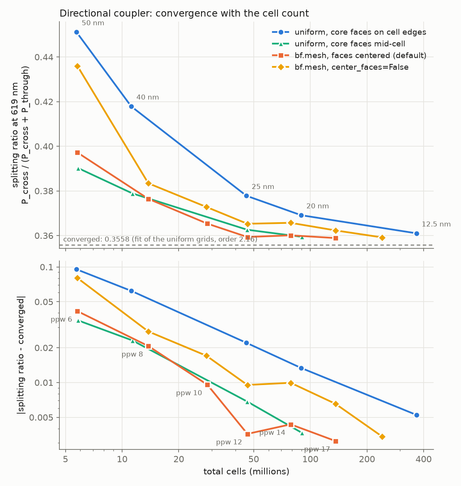

# Non-uniform rectilinear grids

Drivers and results for a `StackDevice` on fdtdx's `RectilinearGrid` (graded x, y and z). Reproduce a run with
`python benchmarks/rectilinear/<driver>.py out.json` from the checkout; each driver's docstring has its options.

## A slab on graded z grids (`graded_slab.py`, `results/graded_slab.json`)

A 137 nm slab of diag(9, 12, 14) at normal incidence (4 x 4 cells periodic in x and y, PML in z,
`averaging="subpixel"`), against the Berreman transfer matrix of `benchmarks/subpixel/berreman.py`; the
Jones matrices at 1.55 um, each run divided by a run without the slab on the same grid. x and y are 40 nm; z
is uniform at 10 or 40 nm, or graded with `bf.graded_edges`: 10 nm within 0.1 um of the slab, growing by at
most 1.25 to 40 nm, 40 nm under the PML. CPU (jax 0.11.2, fdtdx 0.6.3, float32).

| z grid | z cells | time steps | max \|t - t_ref\| | max \|\|r\| - \|r_ref\|\| | energy error |
|---|---|---|---|---|---|
| uniform 10 nm | 360 | 3854 | 1.05e-3 | 5.8e-4 | 5e-6 |
| uniform 40 nm | 90 | 1574 | 1.26e-2 | 5.4e-3 | 1.4e-5 |
| graded 10 / 40 nm | 121 | 3878 | 1.14e-3 | 2.7e-4 | 5.5e-5 |
| graded, the slab's faces on edges | 122 | 3929 | 1.44e-3 | 7.8e-4 | 1.2e-4 |

The graded grid is as accurate as the uniform fine one with a third of its cells; the time steps are the fine
grid's, since the smallest cell sets the time step. Putting the slab's faces on cell edges does not help here:
subpixel averaging already resolves faces inside cells.

With `--case full` (`results/graded_slab_full.json`): the rotated uniaxial tensor with an xz entry of
`benchmarks/subpixel/em_slab.py` (polarization conversion), `averaging="subpixel_full"`:

| z grid | z cells | max \|t - t_ref\| | max \|\|r\| - \|r_ref\|\| | energy error |
|---|---|---|---|---|
| uniform 10 nm | 360 | 9.8e-4 | 5.5e-4 | 5e-6 |
| uniform 40 nm | 90 | 1.17e-2 | 5.1e-3 | 1.3e-5 |
| graded 10 / 40 nm | 121 | 1.10e-3 | 2.3e-4 | 5.4e-5 |
| graded, the slab's faces on edges | 122 | 1.36e-3 | 7.3e-4 | 1.2e-4 |

## The inverse-design bend on graded x, y and z (`graded_bend.py`, `results/bend_*.json`)

The silicon nitride bend of `examples/guide/inverse_design.py` (its geometry, ports and TE0 objective). Graded
grids (`bf.graded_edges`, growth 1.25): the fine cells over the guide, its leads and the reach of the optimized
edges plus the mode's tail in x and y, and around the core in z; the coarse cells in the margins, the silica, the
air and under the PMLs (about 1 um each, on fine cells where a lead runs through one). NVIDIA L40S, float32,
jax 0.11.2, fdtdx 0.6.3. The transmission of the uniform-width bend, against the uniform 40 nm grid:

| grid | cells | time steps | T | T - T(40 nm) | forward run | peak memory |
|---|---|---|---|---|---|---|
| uniform 40 nm | 11.46 M | 6556 | 0.55856 | | 23.8 s | 2.49 GB |
| graded 40 / 80 nm | 7.27 M | 6600 | 0.55900 | +4.4e-4 | 14.2 s | 1.56 GB |
| uniform 60 nm | 3.39 M | 4371 | 0.56342 | +4.9e-3 | 3.8 s | 0.74 GB |
| graded 60 / 120 nm | 2.17 M | 4401 | 0.56874 | +1.0e-2 | 2.0 s | 0.46 GB |

The 40 / 80 nm grid matches the uniform 40 nm one ten times better than uniform 60 nm, with 63 % of its cells and
60 % of its run time. 120 nm cells are too coarse for this guide's mode tail in the silica (the 60 / 120 nm grid is
twice as far off as uniform 60 nm).

Three Adam steps of the example's `bf.jit(jax.value_and_grad(objective))`, the starting parameters committed to
the device (`--commit`):

| grid | checkpoints | step 0 (compile) | steps 1 and 2 | compiles after step 0 | jit cache | peak memory |
|---|---|---|---|---|---|---|
| uniform 60 nm | 60 | 96.0 s (31.2 s) | 58.2 s | 0 | 1 | 21.2 GB |
| graded 60 / 120 nm | 60 | 74.1 s (33.1 s) | 32.4 s | 0 | 1 | 12.9 GB |
| graded 40 / 80 nm | 20 | 266.6 s (32.8 s) | 226.7 s | 0 | 1 | 16.4 GB |

A fixed graded grid compiles once, like a uniform one. The 40 / 80 nm grid's backward pass needs about 45 GB with
60 checkpoints (memory per cell as on the uniform grids), more than the L40S has; 20 checkpoints fit and recompute
more. With an uncommitted start (`jnp.asarray`, as the example had), the uniform 60 nm grid compiled at steps 0 and
1 (jit cache 2, `results/bend_uniform-60.json`): the optimizer's updates come back committed to the device, a new
signature for the jit; the example now commits its start (`jax.device_put`).

## A sloped silicon strip on graded y and z (`graded_guide.py`, `results/guide_*.json`)

A 500 x 220 nm silicon strip in silica with 10 degree walls along x, TE0 at 1.55 um; x is 20 nm on every grid but
uniform 40 nm, y and z graded to 60 nm in the cladding. `neff (mode)` is fdtdx's mode solver on the stack's
averaged cross-section (the source's mode); `neff (FDTD)` the phase slope of Ey along the guide in a full run
(with the Yee dispersion along x).

| grid | cells | neff (mode) | neff (FDTD) | run | peak memory |
|---|---|---|---|---|---|
| uniform 20 nm | 7.68 M | 2.378058 | 2.381383 | 15.1 s | 1.80 GB |
| graded 20 / 60 nm, fine block on uniform 20's cells, 0.2 um past the core | 2.09 M | 2.377985 | 2.381320 | 2.26 s | 0.54 GB |
| the same, 0.6 um past the core | 3.65 M | 2.378057 | 2.381383 | 5.34 s | 0.86 GB |
| graded 20 / 60 nm, fine cells of 19.9 nm (not on uniform 20's lattice) | 2.04 M | 2.380870 | 2.384213 | 2.25 s | 0.53 GB |
| uniform 40 nm | 0.96 M | 2.381357 | 2.394896 | 0.38 s | 0.28 GB |
| uniform 10 nm (mode solver only) | 61.4 M | 2.380052 | | | |

tidy3d's mode solver on the exact geometry (`--reference`, its own subpixel averaging; 2 um square): 2.38667,
2.38323 and 2.38189 at 10, 5 and 2.5 nm, order 1.37, extrapolated 2.38104.

With the fine block on uniform 20 nm's cells, the graded grid gives uniform 20 nm's neff within 7e-5 (0.2 um of
fine cladding) and 7e-7 (0.6 um), at 6.7 and 2.8 times its speed. Cell by cell (`compare_eps.py`,
`results/guide_compare_eps.json`), its inverse permittivity in the 44 x 29 cells where both grids coincide (about 280
of them on the sloped walls) is uniform 20 nm's within 1.5e-6 (Ex, Ey) and 3.0e-6 (Ez), relative 1.1e-5 and
3.7e-5: the float32 positions of the grid's edges (about 1e-5 of a cell). At 20 nm fdtdx's neff still moves by a
few 1e-3 with where the cells fall on the sloped walls (40, 20 and 10 nm: 2.3814, 2.3781, 2.3801), which is the
difference of the graded grid whose fine cells are 19.9 nm.

## Gradients on graded grids (`graded_gradients.py`, `results/gradients.json`)

A silicon strip with a bump on one side (8 degree walls) in silica, 2.4 x 2.0 x 1.32 um, float64 on a CPU; graded
along x, y and z (25 nm around the bump and the core, 50 nm elsewhere) or uniform 40 nm. `jax.grad` against central
differences (steps 1e-4 and 1e-5 um, 1e-3 and 1e-4 degrees; the error against the smaller) of the silicon fractions
weighted by a fixed random field (`weights`), and of the energy of Ey at 1.55 um on a plane past the bump in a full
fdtdx run from a point dipole (`fdtd`, backward through the checkpointed loop; a dipole and a phasor detector read no
mode, so both sides differentiate the same function), for the core's thickness, zmin and sidewall angle and a vertex
of the bump. The largest relative error over the four parameters:

| grid, averaging | weights | fdtd |
|---|---|---|
| graded, subpixel | 3.2e-7 | 4.2e-7 |
| graded, subpixel_full | 3.2e-7 | 9.7e-5 (zmin; its two differences differ by 7e-3) |
| uniform 40 nm, subpixel (core from 0.013 um) | 1.2e-10 | 1.6e-7 |
| uniform 40 nm, subpixel_full (core from 0.013 um) | 1.2e-10 | thickness 4.5e-9; see below |

On the uniform grid with the core from 0 um, its bottom lies on a cell face and its top on a face of Ex's and Ey's
dual cells: the fractions have kinks there, which the central differences straddle. Autodiff gives the mean of the
two sides where the surface's frame coordinate is on the face exactly (the dual faces here) and one side's slope
where rounding puts it next to it ((0 + 0.56) / 0.04 is not exact in binary): both are slopes of the discretized
response, which is not differentiable there.

With `subpixel_full` the uniform grid's bump has its corner (0, 0.4) on a cell's corner, its two walls on the cell's
faces. Until the junction sub-cells' fix (see the changelog) the closure's inverse permittivity jumped there by 2.3e-3
(in 40 voxels by more than 1e-6) as the sidewall angle or zmin moved the corner by about 1e-8 um: a sub-cell holding
the corner switched its laminate between the two walls' normals at round-off. The central differences of zmin,
sidewall angle and the vertex did not converge (they differed by 7e-2 to 1.1 between the two steps; errors 0.088, 1.1
and 0.65). With the fix the tensor is continuous and they converge: sidewall angle 1.5e-9, zmin 2.2e-7, and the vertex
1.2e-3 at 1e-5 um (1e-1 at 1e-4 um: second order, the blend is steep where the corner sits on a sub-cell's corner too;
a band of 0.05 to 0.3 instead of 0.02 to 0.1 gives 1.8e-5, but `validate_closure.py`'s median error of the written
tensor grows from 5.1 % to 5.8 %). The graded results above are unchanged by it (zmin 9.6e-5).

## Automatic meshing (`bf.mesh`): the tail and ppw (`graded_guide.py`, `graded_bend.py`)

`bf.mesh` refines wherever a material is or may come to be (`lambda / (n ppw)` there), plus an evanescent tail past
each boundary in units of its decay length `l = lambda / (2 pi sqrt(n_high^2 - n_low^2))`. NVIDIA L40S, float32.

**The tail** (`results/guide_tails.json`, the sloped silicon strip above, mode solver only, `--mode-only`): 20 nm
cells on uniform-20's lattice over the core and some distance past it, growing to 60 nm in the silica; neff against
uniform 20 nm's (2.378058). `tail-<um>` places the fine block by hand, `mesh-<l>` is `bf.mesh` with 20 nm in silicon,
60 nm in silica (`material_cells`) and a global tail of that many decay lengths (here l = 0.078 um):

| grid | fine cells past the core | cells (of uniform 20) | neff - uniform 20 |
|---|---|---|---|
| tail-0 | none | 19 % | -3.3e-3 |
| tail-0.1 | 0.1 um | 23 % | -5.4e-4 |
| tail-0.2 | 0.2 um | 27 % | -9.5e-5 |
| tail-0.4 | 0.4 um | 37 % | -4.1e-6 |
| mesh-1 | 1 l | 23 % | -5.5e-4 |
| mesh-2 | 2 l | 28 % | -1.3e-4 |
| mesh-3 (the default) | 3 l | 40 % | -2.9e-5 |
| mesh-5 | 5 l | 89 % | -9.5e-7 |

The error falls by about 6 per 0.1 um, as the field energy past the fine cells does (`exp(-2 x / delta)`, delta =
0.131 um for this mode): the tail is about the evanescent field, also around geometry that never moves. Without it the
graded grid gives up as much as uniform 40 nm does (3.3e-3). The fine cells must stay on one lattice for such
comparisons: at 20 nm fdtdx's neff moves by a few 1e-3 with where the cells fall on the sloped walls, which is why
`bf.mesh` puts its finest cells on the lattice of their width from the box's face (`align_fine`), with narrower PML
cells where wide ones cannot reach it. The ppw sweep on this strip (`results/guide_ppw.json`, ppw 14 / 18 / 22 / 26:
-1.1e-3 / +1.8e-3 / -3.3e-5 / +7.2e-4 against uniform 20) is dominated by that placement, not by the cell size.

**The inverse-design bend** (`results/bend_mesh*.json`): the transmission of the uniform-width bend on `bf.mesh`'s
grids, `dilation={"WG": 0.45}` (the half-widths' reach), the default tail, against uniform 40 nm (11.46 M cells,
0.55856, 23.8 s) and the hand-set graded 40 / 80 nm grid of the section above:

| grid | cells (of uniform 40) | smallest cells | T - T(40 nm) | forward run |
|---|---|---|---|---|
| hand-set graded 40 / 80 nm | 63 % | 40 nm | +4.4e-4 | 14.2 s |
| mesh: 40 nm in the core, 80 nm in air and silica (`material_cells`) | 66 % | 40 nm | -3.0e-5 | 14.8 s |
| mesh-auto-20: ppw 20 | 85 % | 38 nm | -3.6e-4 | 20.4 s |
| mesh-auto-17: ppw 17 | 51 % | 45 nm | +2.6e-3 | 9.9 s |
| mesh-auto: ppw 14 | 29 % | 55 nm | +9.8e-3 | 3.8 s |

With the hand-set grid's choices, `bf.mesh` (its fine region from the dilation and the tail alone) is 15 times closer
to uniform 40 nm. ppw 20 is the default; ppw 14 is about uniform 60 nm (+4.9e-3, 30 % of the cells), for fast
optimizations. The silica under the bend spans every x and y plane, so at ppw 20 its 54 nm target caps the lateral
cells everywhere (the tensor product); coarsening it with `material_cells` (80 nm, about 13 cells per wavelength in
silica) saves a fifth of the cells at no cost in accuracy here.

## The directional coupler: convergence with the cell count (`dc_convergence.py`, `plot_dc_convergence.py`)

The silicon-nitride directional coupler of `examples/fdtdx_directional_coupler.py` (43 x 6.4 x 2.6 um, a 300 nm gap
over 20 um); the splitting ratio `P_cross / (P_cross + P_through)` at 619 nm, on uniform grids and on `bf.mesh`'s
(band 538 to 728 nm, ppw 6 to 20, the default tail). Float32; L40S, and an H200 for the two largest grids (241 M and
366 M cells: about 205 bytes per cell at peak, mostly `apply_stack`'s painting, 49 and 75 GB).
`results/dc_convergence.jsonl`, plotted in `results/dc_convergence.png`:

The splitting ratio is very sensitive: the coupling falls about as `exp(-8.9 gap / um)`, so 1 nm of effective gap moves
it by about 6e-3. Its error depends on where the core's faces (z = +-0.1 um) fall in their cells, and the uniform grids
always put them on cell edges (the box is whole cells from them); shifted half a cell in z
(`uniform-<nm>@3.2,<half height>`) they sit mid-cell:

| uniform grid | core faces | 50 nm | 40 nm | 25 nm | 20 nm | 12.5 nm |
|---|---|---|---|---|---|---|
| the box's own lattice | on edges | 0.45116 | 0.41787 | 0.37780 | 0.36911 | 0.36100 |
| shifted half a cell in z | mid-cell | 0.39023 | 0.37887 | 0.36259 | 0.35943 | (queued) |

One fit `S0 + C h^p` to those of 25 nm and finer, with S0 and p shared and C per placement, gives **S0 = 0.3558**, p = 2.16,
C = 2.1e-5 (on edges) and 6.4e-6 (mid-cell) per nm^p, rms 2.8e-4: the placement sets the error constant, not the
limit. (Fits of 25 and 20 nm alone, at p = 2, gave 0.3537 for both placements; 12.5 nm showed that range was not yet
asymptotic.) Shifting the lattice in y instead (the gap's walls on edges or mid-cell) moves the ratio by under 1e-3.

`bf.mesh`'s lattice starts at the box's face, so its finest cells put the core's faces 0.17 to 0.44 into a cell. Against
S0 its error at ppw 14, 17 and 20 (core cells 19, 16 and 13 nm) is 9.9e-3, 6.6e-3 and 3.4e-3; divided by h^2.16 that is
1.75e-5, 1.66e-5 and 1.35e-5, about constant and between the two uniform placements' constants. It has no offset of its
own: it converges to the same value.

The mesher itself is not the source of any difference. On the lattices of the uniform grids (`cells-<core>-<clad>`:
`material_cells` forcing both materials to 20 or 25 nm) `bf.mesh`'s pipeline gives uniform 20 and 25 nm's ratios
within 5e-6 (the same edges as a `RectilinearGrid`, with `grid=` on the ports and `Mesh.boundary`); grading the oxide
from the 20 nm core to 27 or 40 nm in y and z moves it by 4e-6 and 2.8e-5, with 76 % and 56 % of the cells.

So `bf.mesh` puts every level's bottom and top face in the middle of a z cell by default (`center_faces=True`; the
runs above without it are `meshoff-<ppw>`). Both core faces then sit at 0.46 to 0.54 of their cells; the cell counts
stay the same (ppw 10: +1.4 %) and the time steps grow by 1 to 5 % (the smallest z cell comes out 1 nm smaller, 6 nm
at ppw 6). Against S0:

| ppw | cells | faces not centered | faces centered (default) |
|---|---|---|---|
| 6 | 5.8 M | 8.0e-2 | 4.1e-2 |
| 8 | 13.8 M | 2.8e-2 | 2.1e-2 |
| 10 | 28 M | 1.7e-2 | 9.6e-3 |
| 12 | 46 M | 9.5e-3 | 3.6e-3 |
| 14 | 79 M | 1.0e-2 | 4.4e-3 |
| 17 | 136 M | 6.6e-3 | 3.1e-3 |

Centering removes a third to two thirds of the error. At the coarsest cells a uniform grid with its faces mid-cell is
still a little closer (50 nm: 3.5e-2 against ppw 6's 4.1e-2, both 5.8 M cells; level at about 14 M; not
investigated). From ppw 10 on `bf.mesh` is ahead: ppw 12 (46 M cells, 160 s) matches uniform 20 nm with its faces
mid-cell (90 M, 348 s:
3.7e-3) and beats the
uniform grids as the box makes them (faces on edges: 20 nm, 89 M, 1.3e-2; 12.5 nm, 366 M, 5.3e-3). Differences of a
few 1e-3 are within S0's own uncertainty (pairwise h^2 extrapolations spread over about 2e-3).
