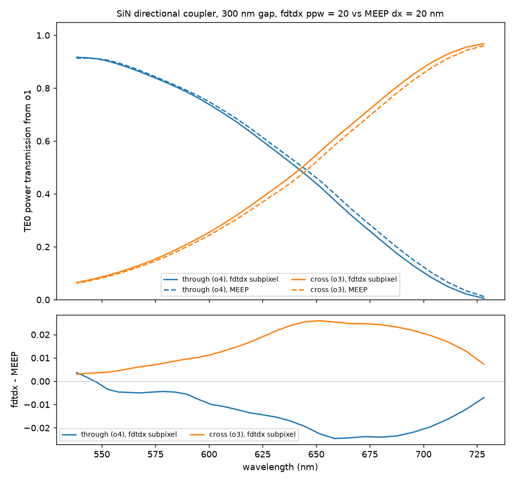

# Directional coupler

[`examples/fdtdx_directional_coupler.py`](https://github.com/Sephiram591/bifrost/blob/main/examples/fdtdx_directional_coupler.py)
simulates a broadband silicon-nitride directional coupler: two 400 nm wide, 200 nm tall SiN (n = 1.95) waveguides in oxide
(n = 1.457). They start 3 µm apart, two cosine S-bends bring them to a 300 nm gap along a 20 µm straight coupling section,
and two more S-bends separate them again (gaps are edge to edge). TE0 is launched into o1 (lower left) with one short
pulse, and mode monitors on the input and on the two outputs record the TE0 amplitudes at 31 frequencies, evenly spaced over
the center frequency ± 15 % (538 to 728 nm, centered on 619 nm), so a single run gives the whole power spectrum.
[`examples/meep_directional_coupler.py`](https://github.com/Sephiram591/bifrost/blob/main/examples/meep_directional_coupler.py)
runs the same structure in MEEP, and
[`examples/compare_directional_coupler.py`](https://github.com/Sephiram591/bifrost/blob/main/examples/compare_directional_coupler.py)
plots the two together:



Both runs use the same polygons (the MEEP script reads the ones the fdtdx `StackDevice` draws), the same Gaussian pulse
(spectral width 10 % of the center frequency), the same 0.5 µm PML, the same 2.0 × 1.4 µm source and monitor planes, and
the same 400 fs of simulated time; fdtdx uses `bf.mesh` at its default `ppw = 20` (`pml = 0.5` µm), while MEEP runs on a
uniform 20 nm grid. The transmission is `|a_out / a_in|^2` with `a_in` the forward TE0 amplitude at the input monitor.

## Run it

```bash
# fdtdx, on a GPU (default ppw=20, 207.6M cells: about 21 minutes on an L40S, peaking at 40.6 GiB)
python examples/fdtdx_directional_coupler.py            # optional arguments: ppw (20), averaging (subpixel)
python examples/fdtdx_directional_coupler.py 16 subpixel_full   # full tensor at ppw=16 (106.6M cells) on an H200; ppw=20 needs >100 GiB

# MEEP, on CPUs (about 45 minutes on 48 cores at 20 nm)
python examples/meep_directional_coupler.py export      # writes examples/output/geometry_dc.json
mpirun -np 48 python examples/meep_directional_coupler.py run

python examples/compare_directional_coupler.py          # optional arguments: fdtdx ppw (20), MEEP dx in nm (20)
```

The results are saved as `examples/output/fdtdx_dc_ppw<ppw>.npz` and `examples/output/meep_dc_<nm>nm.npz`, and the
comparison writes `directional_coupler_spectra.png` and `directional_coupler_fields.png` next to them. The comparison
plots whichever of the fdtdx runs (`subpixel`, the default, and `subpixel_full`) and the MEEP run exist.

## What the comparison shows

TE0 power at the two outputs, `fdtdx` with `bf.mesh` (`ppw = 20`) vs. MEEP at 20 nm (the rest of the input power is lost or reflected: 0.6 to 2.7 % across the sampled band in fdtdx):

| wavelength (nm) | through, fdtdx | through, MEEP | cross, fdtdx | cross, MEEP |
| ---: | ---: | ---: | ---: | ---: |
| 538.3 | 0.9170 | 0.9133 | 0.0652 | 0.0621 |
| 584.0 | 0.8072 | 0.8119 | 0.1869 | 0.1783 |
| 619.0 | 0.6362 | 0.6497 | 0.3535 | 0.3368 |
| 658.5 | 0.3766 | 0.4012 | 0.6089 | 0.5836 |
| 703.4 | 0.0851 | 0.1046 | 0.8952 | 0.8756 |
| 728.2 | 0.0049 | 0.0119 | 0.9683 | 0.9610 |

The cross-port power rises from 6.5 % to 96.8 % over the band, as the coupling length shortens with wavelength; the 50:50
point is at 643.3 nm in fdtdx and 647.0 nm in MEEP (-3.7 nm). Across all 31 frequencies the two solvers agree to within
0.026 in power (max |diff| 0.0246 through, 0.0259 cross; rms 0.0146 through, 0.0164 cross), and the `|E|^2` field map
on `z = 0` at 619 nm agrees with a relative difference of 0.062. MEEP's uniform 20 nm grid resolves the 300 nm gap with
15 cells (89.4M total cells); with adaptive meshing, `bf.mesh` already converges to 0.3548 cross-port transmission at
619 nm using `ppw=16` (106.6M cells) and gives 0.3535 at `ppw=20` (207.6M cells).

Full-tensor subpixel averaging (`averaging="subpixel_full"`, the off-diagonal tensor entries at bends and corners)
requires >48 GiB of GPU memory at `ppw = 20` (207.6M cells) and fits on an H200/B200; on the `ppw = 16` benchmark
(106.6M cells; see [Diagonal vs. full-tensor averaging](../guide/convergence-testing.md#diagonal-vs-full-tensor-averaging))
`subpixel` and `subpixel_full` agree within `4e-5` in power across the band.

On 207.6M cells `fdtdx` (`subpixel`) took 1285 s on one NVIDIA L40S, compilation included, peaking at 40.6 GiB of GPU
memory. MEEP took 2720 s on 48 CPU cores (89.4M cells).

## Things to try

- **Change the geometry.** `GAP`, `PORT_GAP`, `COUPLING` and `BEND` at the top of `fdtdx_directional_coupler.py` are in µm.
  The coupling length for a full transfer is about 57 µm at 619 nm for a 300 nm gap (an MPB estimate), so `COUPLING`
  sets where the 50 % split falls in the band.
- **Change the band.** `BANDWIDTH` (the half width as a fraction of the center frequency), `N_FREQ` and `PULSE_WIDTH`
  set the monitored frequencies and the pulse; keep the pulse spectrum well above the noise floor at the band edges.
  Re-run `export` for MEEP after changing any of these.
