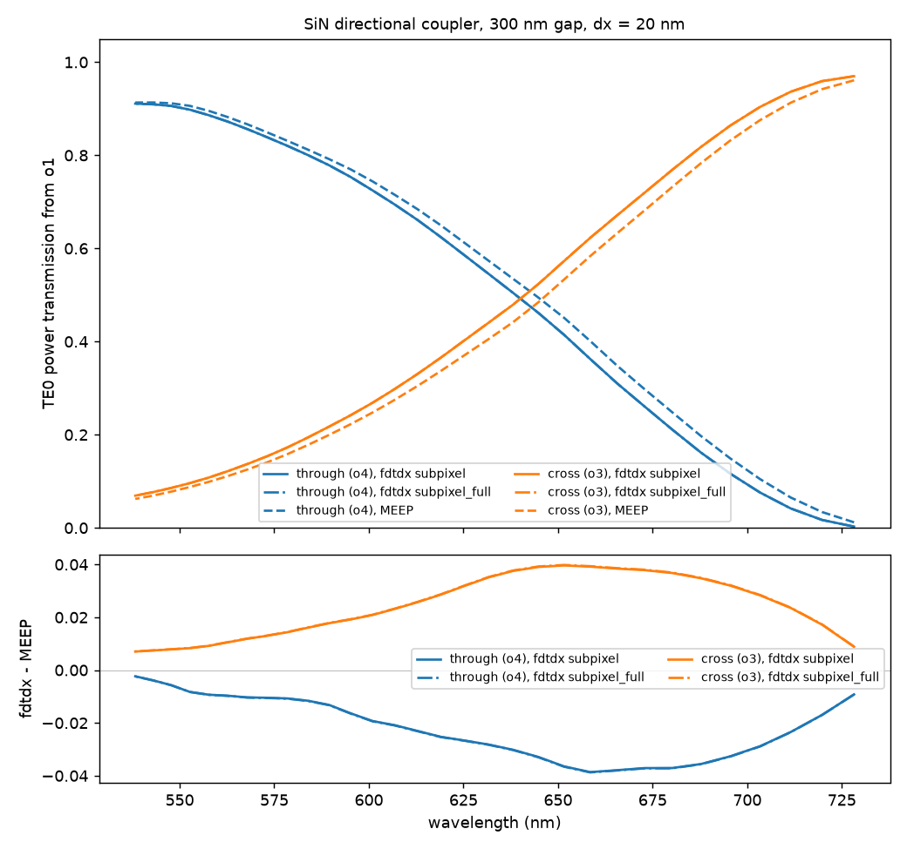

# Directional coupler

[`examples/fdtdx_directional_coupler.py`](https://github.com/Sephiram591/bifrost/blob/main/examples/fdtdx_directional_coupler.py)
simulates a broadband silicon-nitride directional coupler: two 400 nm wide, 200 nm tall SiN (n = 1.95) waveguides in oxide
(n = 1.457). They start 3 µm apart, two cosine S-bends bring them to a 300 nm gap along a 20 µm straight coupling section,
and two more S-bends separate them again (gaps are edge to edge). TE0 is launched into o1 (lower left) with one short
pulse, and mode monitors on the input and on the two outputs record the TE0 amplitudes at 31 frequencies, evenly spaced over
the center frequency ± 15 % (538 to 728 nm, centered on 619 nm), so a single run gives the whole power spectrum.
[`examples/meep_directional_coupler.py`](https://github.com/Sephiram591/bifrost/blob/main/examples/meep_directional_coupler.py)
runs the same structure in MEEP, and
[`examples/compare_directional_coupler.py`](https://github.com/Sephiram591/bifrost/blob/main/examples/compare_directional_coupler.py)
plots the two together:



Both runs use the same polygons (the MEEP script reads the ones the fdtdx `StackDevice` draws), the same 20 nm grid, the
same Gaussian pulse (spectral width 10 % of the center frequency), the same 0.5 µm PML, the same 2.0 × 1.4 µm source and
monitor planes, and the same 400 fs of simulated time. The transmission is `|a_out / a_in|^2` with `a_in` the forward TE0
amplitude at the input monitor.

## Run it

```bash
# fdtdx, on a GPU (one run, 89M cells at 20 nm: about 6 minutes on an L40S)
python examples/fdtdx_directional_coupler.py            # optional arguments: the grid cell in um (0.02), the averaging
python examples/fdtdx_directional_coupler.py 0.02 subpixel_full   # about 20 minutes on an H200, peaking at 50 GiB

# MEEP, on CPUs (about 45 minutes on 48 cores at 20 nm)
python examples/meep_directional_coupler.py export      # writes examples/output/geometry_dc.json
mpirun -np 48 python examples/meep_directional_coupler.py run

python examples/compare_directional_coupler.py          # optional argument: the grid cell in nm, default 20
```

The results are saved as `examples/output/{fdtdx,meep}_dc_<nm>nm.npz` and the comparison writes
`directional_coupler_spectra.png` and `directional_coupler_fields.png` next to them. The box (43 × 6.4 × 2.6 µm) is a
whole number of cells at 20 and 40 nm. The comparison plots whichever of the fdtdx runs (`subpixel`, the default, and
`subpixel_full`) and the MEEP run exist for the grid.

## What the comparison shows

TE0 power at the two outputs, 20 nm grid (the rest of the input power is lost or reflected: 0.6 to 2.7 % across the band in fdtdx):

| wavelength (nm) | through, fdtdx | through, MEEP | cross, fdtdx | cross, MEEP |
| ---: | ---: | ---: | ---: | ---: |
| 538 | 0.911 | 0.913 | 0.069 | 0.062 |
| 584 | 0.800 | 0.812 | 0.194 | 0.178 |
| 619 | 0.625 | 0.650 | 0.365 | 0.337 |
| 658 | 0.363 | 0.401 | 0.623 | 0.584 |
| 703 | 0.076 | 0.105 | 0.904 | 0.876 |
| 728 | 0.003 | 0.012 | 0.970 | 0.961 |

The cross-port power rises from 7 % to 97 % over the band, as the coupling length shortens with wavelength; the 50:50
point is at 641.3 nm in fdtdx and 647.0 nm in MEEP. The two
solvers agree to within 0.04 in power everywhere (rms 0.025); fdtdx couples slightly more, as if its curve were shifted by
about 5 nm. The difference shrinks with the grid: at 40 nm it is up to 0.08. Between 40 and 20 nm fdtdx's cross power at
619 nm moves from 0.414 to 0.365 while MEEP's moves from 0.351 to 0.337, so the remaining difference is probably
resolution-limited (the 300 nm gap is 15 cells at 20 nm); a finer grid was not run.

Running fdtdx with `averaging="subpixel_full"` (the full permittivity tensor with its off-diagonal entries, the most
accurate option) changes none of this: its spectra are within 2e-4 in power of the default `subpixel` run at every
wavelength, the 50:50 point moves by 0.1 nm, and the difference from MEEP is the same. So the remaining 5.7 nm offset is
not from how fdtdx averages the permittivity at the guide walls; its cause has not been investigated.

On the same 89.4M cells fdtdx took 383 s on one NVIDIA L40S with `subpixel`, compilation included, and 1203 s on an H200 with
`subpixel_full`, which peaked at 50 GiB of GPU memory. MEEP took 2720 s on 48 CPU cores.

## Things to try

- **Change the geometry.** `GAP`, `PORT_GAP`, `COUPLING` and `BEND` at the top of `fdtdx_directional_coupler.py` are in µm.
  The coupling length for a full transfer is about 57 µm at 619 nm for a 300 nm gap (an MPB estimate), so `COUPLING`
  sets where the 50 % split falls in the band.
- **Change the band.** `BANDWIDTH` (the half width as a fraction of the center frequency), `N_FREQ` and `PULSE_WIDTH`
  set the monitored frequencies and the pulse; keep the pulse spectrum well above the noise floor at the band edges.
  Re-run `export` for MEEP after changing any of these.
