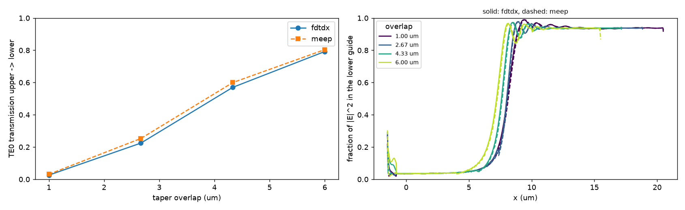

# Example: elevator coupler

[`examples/fdtdx_elevator_coupler.py`](https://github.com/Sephiram591/bifrost/blob/main/examples/fdtdx_elevator_coupler.py)
simulates an adiabatic coupler between two SiN tapers on different levels. TE0
at 619 nm is launched into the upper taper, and the script sweeps the taper
overlap. [`examples/meep_elevator_coupler.py`](https://github.com/Sephiram591/bifrost/blob/main/examples/meep_elevator_coupler.py)
runs the same structure in MEEP, and
[`examples/compare_elevator_coupler.py`](https://github.com/Sephiram591/bifrost/blob/main/examples/compare_elevator_coupler.py)
plots the two together:



Run the fdtdx example on a GPU:

```bash
python examples/fdtdx_elevator_coupler.py
```
