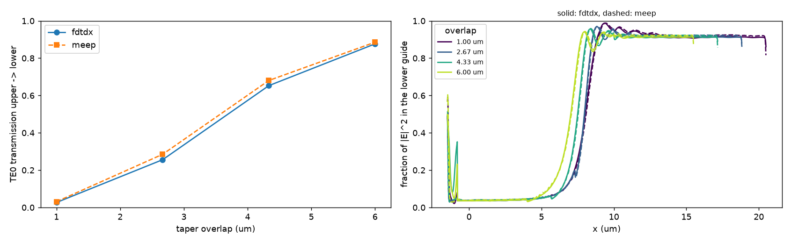

# Elevator coupler

[`examples/fdtdx_elevator_coupler.py`](https://github.com/Sephiram591/bifrost/blob/main/examples/fdtdx_elevator_coupler.py)
simulates an adiabatic elevator coupler between two SiN (`n = 2.0`) tapers on different vertical levels over an oxide
(`n = 1.457`) substrate in air (`n = 1.0`). The upper taper (`upper`, `190 nm` thick at `zmin = 0.0` µm) sits on the
oxide surface, while the lower taper (`lower`, `110 nm` thick at `zmin = -0.21` µm, `mesh_order = 1` over the oxide's
`mesh_order = 9`) sits with its top `100 nm` below the oxide surface. Each taper is `10` µm long, tapering between
`650 nm` (`0.65` µm) and `50 nm` (`0.05` µm) with `0.5` µm straight leads carrying ports `o1` (upper) and `o2` (lower)
and `1.0` µm port extensions through the `0.5` µm PML.

TE0 at `619 nm` is launched into `o1` with a Gaussian pulse (spectral width `5 %` of the center frequency,
`port_offset = -0.3` µm), mode-overlap monitors at `o1` (`direction="in"`) and `o2` record the TE0 transmission
`|a_out / a_in|^2` across four taper overlaps (`1.00`, `2.67`, `4.33`, `6.00` µm), and a `PhasorDetector` on `y = 0`
records `|E|^2` in the `xz` plane.
[`examples/meep_elevator_coupler.py`](https://github.com/Sephiram591/bifrost/blob/main/examples/meep_elevator_coupler.py)
exports the `StackDevice`'s polygons and `LayerStack` levels to JSON and runs the matching 3D simulation in MEEP, and
[`examples/compare_elevator_coupler.py`](https://github.com/Sephiram591/bifrost/blob/main/examples/compare_elevator_coupler.py)
plots the two together:



Both solvers use the same `20 nm` (`0.02` µm) default grid, `0.5` µm PML, `5 %` Gaussian pulse, and mode planes
(`2.9 × 1.5` µm on `o1`, `2.9 × 2.0` µm on `o2`). The `fdtdx` run simulates `400 fs` (`400e-15` s) in a
`(23.0 - overlap) × 4.0 × 3.0` µm box (up to `1100 × 200 × 150 = 33M` cells at `1.00` µm overlap; see
[Full tensors](../guide/geometry-model.md#full-tensors)); MEEP runs until DFT decay (`tol=1e-5`) with `ODD_Y` parity
and Y mirror symmetry unless `--nosym` is passed.

## Run it

```bash
# fdtdx sweep on a GPU (overlaps 1.00, 2.67, 4.33, 6.00 um; writes examples/output/fdtdx_overlap_<overlap>.npz)
python examples/fdtdx_elevator_coupler.py

# MEEP reference on CPUs
# 1. export the StackDevice polygons and LayerStack levels (optional positional resolution in um, default 0.02)
python examples/meep_elevator_coupler.py export
# 2. run each overlap (writes examples/output/meep_overlap_<overlap>.npz; options: --res, --tag, --nosym)
mpirun -np 48 python examples/meep_elevator_coupler.py run 1.00
mpirun -np 48 python examples/meep_elevator_coupler.py run 2.67
mpirun -np 48 python examples/meep_elevator_coupler.py run 4.33
mpirun -np 48 python examples/meep_elevator_coupler.py run 6.00

# Compare transmissions, |E|^2 maps and eps contours (writes elevator_coupler_*.png under examples/output/)
python examples/compare_elevator_coupler.py
```

## What the comparison shows

- **Transmission vs. overlap:** As the taper overlap increases from `1.00` to `6.00` µm, TE0 power transferred from the
  upper guide (`o1`) to the lower guide (`o2`) rises smoothly from near zero (~0.03 at `1.00` µm) to nearly complete
  coupling (~0.88–0.89 at `6.00` µm), with `fdtdx` and MEEP agreeing closely across all four points.
- **Power transfer along the taper:** Integrating `|E|^2` over the lower guide (`z <= -0.06` µm) relative to the total
  waveguide cross-section shows the same progressive transfer profile along `x` in `fdtdx` (solid) and MEEP (dashed).
- Running `python examples/compare_elevator_coupler.py` on generated `.npz` files prints the exact per-overlap table
  (`T fdtdx`, `T meep`, and relative `|E|^2` difference on `y = 0`) and writes `elevator_coupler_fields.png` alongside
  `elevator_coupler_transmission.png`; exact tabulated sweep numbers and wall-clock runtimes are not pre-stored in the
  repository.

## Things to try

- **Sweep geometry or grid:** `WAVELENGTH`, `LENGTH`, `W_MAX`, `W_MIN`, `LAYER_STACK`, and the
  `np.linspace(1, 6, 4)` overlap sweep sit in `examples/fdtdx_elevator_coupler.py`, and
  `simulate(overlap, resolution=..., time=...)` sets the grid spacing and duration. Re-run
  `python examples/meep_elevator_coupler.py export [resolution]` after changing geometry constants.
- **Disable MEEP symmetry:** pass `--nosym` to `examples/meep_elevator_coupler.py run` to omit `mp.Mirror(mp.Y, phase=-1)`
  when testing asymmetric edits (writes `*_nosym.npz`).
