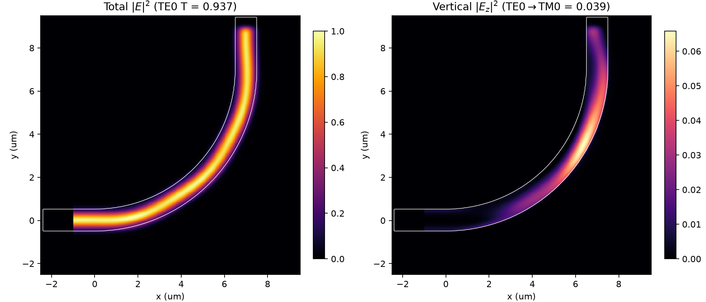

# Lithium niobate bend

[`examples/linbo3_bend.py`](https://github.com/Sephiram591/bifrost/blob/main/examples/linbo3_bend.py) simulates a 90° X-cut thin-film lithium niobate (TFLN) ridge waveguide bend (`1.2 × 0.50 µm` core, `R = 7.0 µm`, `20°` trapezoidal sidewalls, `12.00 × 12.00 × 4.80 µm` box) on a full-wafer silica bottom oxide (`n = 1.444`) in air (`n = 1.0`) at `1.55 µm`.

In simulation coordinates (crystallographic X along `z`, optic axis Z along `y`, and Y along `x`), the ordinary and extraordinary refractive indices `n_o = 2.211` and `n_e = 2.138` give a diagonally anisotropic permittivity tensor `(n_o^2, n_e^2, n_o^2)`:

- Launching `TE0` into port `o1` (`+x` propagation, `E` predominantly along `y`/Z) sees `n_e` (`n_eff,in = 1.7822` at `ppw=20`, converging to `1.7815`).
- Exiting port `o2` (`+y` propagation, `E` predominantly along `x`/Y) sees `n_o` (`n_eff,out = 1.8397` at `ppw=20`, converging to `1.8390`).
- The `20°` sloped sidewalls on an asymmetric silica/air stack break vertical mirror symmetry and hybridize `TE0` into `TM0` around the bend (`TE0 -> TM0` conversion `0.0386` at `ppw=20`, converging to `0.042` at fine grids).



## The script

```python
--8<-- "examples/linbo3_bend.py"
```

## Run it

```bash
python examples/linbo3_bend.py                    # ppw=20 adaptive grid + silica coarsening (~25 s FDTD on GPU)
python examples/linbo3_bend.py --ppw 10           # coarse check (~1.36M cells)
python examples/linbo3_bend.py --ppw 27 --averaging subpixel_full --figure linbo3_full.png
```

| Option | Meaning |
| --- | --- |
| `--ppw` | points per local wavelength (`bf.mesh(..., ppw=...)`); default `20` |
| `--duration` | simulated time in seconds; default `500e-15` |
| `--averaging` | Kottke homogenization mode: `subpixel` (diagonal, default) or `subpixel_full` (full 3 × 3 tensor) |
| `--no-coarsen-substrate` | refine the full-wafer silica oxide at the core `ppw` instead of coarsening via `Refine.material_cells` |
| `--figure` | where to save the two-panel `|E|^2` / `|E_z|^2` image; default `linbo3_bend_field.png` |

## Convergence and MEEP comparison

The table below summarizes convergence runs from `benchmarks/meshing/accuracy_per_cell.py` (NVIDIA L40S, `float32`) alongside native `mp.Prism`/`mp.Block` uniform-grid reference runs from `benchmarks/meshing/meep_uniform.py` (16 MPI CPU ranks). See [Convergence testing](../guide/convergence-testing.md) for the full convergence curves and [Diagonal vs full-tensor averaging](../guide/convergence-testing.md#diagonal-vs-full-tensor-averaging) for the full-tensor overhead trade-off.

| Configuration | Total cells | Peak / equiv. VRAM | FDTD runtime | `TE0` transmission | `TE0 -> TM0` |
| --- | --- | --- | --- | --- | --- |
| `bf.mesh` + `material_cells` (`ppw=20`, `subpixel`) | 8.91M | 2.93 GB | 25.2 s | 0.9369 | 0.0386 |
| `bf.mesh` (`ppw=20`, `subpixel`, uncoarsened BOX) | 10.33M | 3.19 GB | 30.4 s | 0.9369 | 0.0386 |
| `bf.mesh` + `material_cells` (`ppw=20`, `subpixel_full`) | 8.91M | 5.53 GB | 123.9 s | 0.9341 | 0.0413 |
| `bf.mesh` + `material_cells` (`ppw=36`, `subpixel`) | 50.59M | 11.60 GB | 254.9 s | 0.9337 | 0.0415 |
| `bf.mesh` + `material_cells` (`ppw=36`, `subpixel_full`) | 50.59M | 30.51 GB | 1954.0 s | 0.9322 | 0.0429 |
| `bf.mesh` (`ppw=48`, `subpixel`) | 139.18M | 31.72 GB | 941.7 s | 0.9330 | 0.0423 |
| `bf.mesh` + `material_cells` (`ppw=51`, `subpixel`) | 142.63M | 32.39 GB | 996.8 s | 0.9329 | 0.0424 |
| `UniformGrid` (`17 nm`, `subpixel`) | 140.56M | 32.31 GB | 837.8 s | 0.9330 | 0.0421 |
| `UniformGrid` (`24 nm`, `subpixel_full`) | 50.00M | 30.32 GB | 1186.9 s | 0.9319 | 0.0431 |
| `MEEP UniformGrid` (`17 nm`, 16 CPUs) | 140.56M | 32.31 GB (equiv.) | 6795.3 s | 0.9331 | 0.0419 |

At `17 nm` (`140.56M` cells), MEEP yields `n_eff,in = 1.7778` and `n_eff,out = 1.8344`, and agrees with `bifrost` within `8.3e-5` on `TE0` transmission and `2.2e-4` on `TM0` conversion while `bifrost` runs **8.1× faster** on one NVIDIA L40S GPU.

## Things to try

- **Suppress polarization conversion.** Set `SIDEWALL_ANGLE = 0.0` at the top of the file to inspect how vertical sidewalls eliminate the sidewall symmetry breaking.
- **Inspect off-diagonal sidewall averaging.** Run `--averaging subpixel_full` to include off-diagonal Kottke tensor components generated along the curved 20° ridge walls; at `ppw=36` + `material_cells`, `subpixel` and `subpixel_full` agree within `1.5e-3` on `T`.
- **Inspect 3D geometry and fields.** Call `open_viewer(result)` interactively to inspect the trapezoidal LiNbO₃ ridge and electric-field slices in the 3D viewer.
