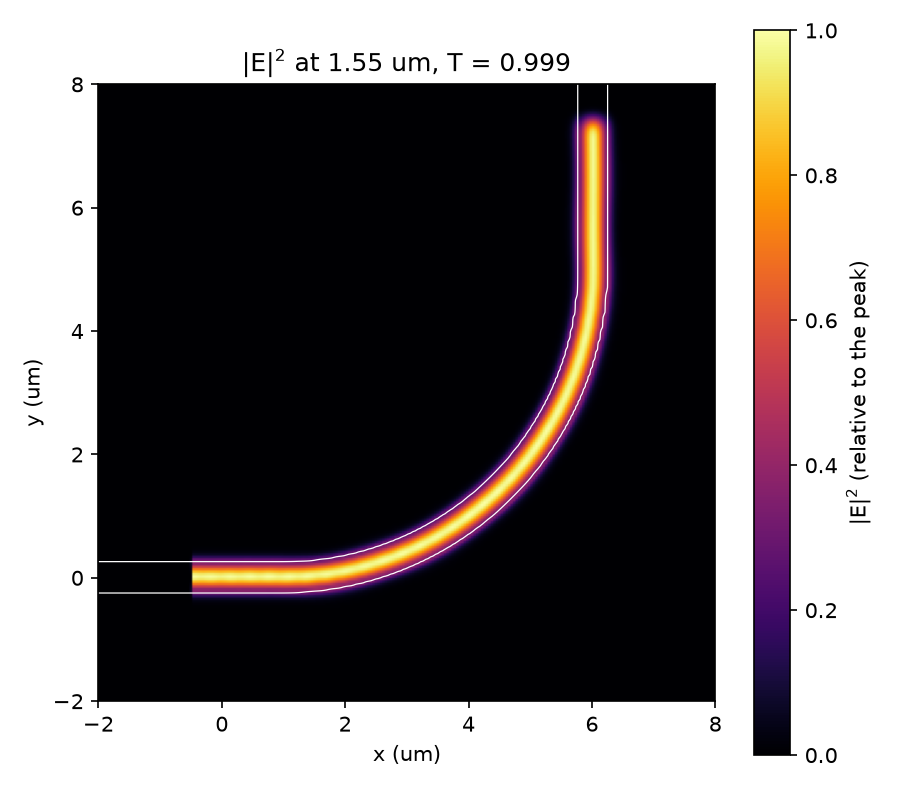

# Getting started: your first simulation

A 90° silicon waveguide bend, simulated by
[`examples/waveguide_bend.py`](https://github.com/Sephiram591/bifrost/blob/main/examples/waveguide_bend.py): a
transmission value, a field image, and the result open in the viewer. [Install bifrost](installation.md) first, and run
the script on a GPU if you have one.

The device is a 500 nm wide, 220 nm thick silicon strip in silica: gdsfactory's `bend_circular` cell, a 5 µm radius
arc, with both ports extended straight to the edge of the simulation box. TE0 light at 1.55 µm is launched into the
extension of port `o1`, and the script measures how much of it leaves port `o2` in TE0.

## Run it

Save the [complete script](#the-complete-script) as `waveguide_bend.py` and run it:

```bash
python waveguide_bend.py
```

Output on an NVIDIA L40S (yours will differ slightly):

```text
transmission: 1.0008
wall time:    32.4 s (compilation included)
peak memory:  1.2 GiB on cuda:0
field image:  waveguide_bend_field.png
```



A transmission a little above 1 is not gain: it is the numerical error of the mode amplitudes at this grid, a few parts
in a thousand, and it shrinks as the grid is refined (see [Choosing the settings](#choosing-the-settings)). A bend this
wide loses less than that error.

!!! note "How long it takes"
    About half of the first run is compiling the solver: in one process, the first simulation took 32.7 s and an
    identical second one 16.1 s. Without a GPU, try a coarser grid first (`--resolution 0.1` took 31 s on 4 CPU cores,
    with a transmission of 0.980). The settings are chosen to be quick, not converged.

## The script, step by step

### 1. The component

`gf.components.bend_circular`, a gdsfactory parametric cell, makes a circular arc with a port at each end: `o1` faces
west (`orientation` 180°) and `o2` faces north (90°). The cell and the waveguide layer `gf.gpdk.LAYER.WG` come from the
generic PDK, which `gf.gpdk.PDK.activate()` loads. Any other cell, or a component you built yourself, works the same
way. Lengths are in µm.

```python
--8<-- "examples/waveguide_bend.py:imports"

--8<-- "examples/waveguide_bend.py:parameters"

--8<-- "examples/waveguide_bend.py:component"
```

### 2. The layer stack and materials

The `LayerStack` has one level: the core, on the waveguide layer, 0.22 µm thick from `z = 0`. The materials are
constant-index silicon for the core and silica for the cladding.

```python
--8<-- "examples/waveguide_bend.py:layerstack"
```

### 3. The device

`StackDevice.from_layer_stack` voxelizes the component through the stack. `background="clad"` fills everything the core
does not. `extend_ports` continues both ports straight out by 2.5 µm, so the guide runs through the absorbing boundary
instead of ending inside the simulation. `boundary_offset` sets the box: the faces that hold a port stay put, the others
move out by 2.25 µm in x and y, and the box is 3.4 µm tall, 10 × 10 × 3.4 µm in all.

```python
--8<-- "examples/waveguide_bend.py:stack"
```

!!! note "Keep the box on the grid"
    fdtdx rounds each side of the box to a whole number of grid cells when it places it: a 10.03 µm side on a 40 nm grid
    becomes 10.04 µm, so the simulated box can differ from `boundary_offset` by up to half a cell, and changes with the
    grid. The script's 10 µm and 3.4 µm are whole numbers of cells at 50, 40, 25 and 20 nm, so the box is the same in
    every run of the [table below](#choosing-the-settings). A side exactly halfway between two cell counts (3.42 µm is
    85.5 cells of 40 nm) can make fdtdx stop with `Configured grid shape ... does not match simulation volume shape`.

### 4. Wavelength, grid, duration and boundaries

These are fdtdx objects, and fdtdx works in **meters**: the script's µm lengths are multiplied by `1e-6` where they
enter. `SimulationConfig` takes the simulated time and the grid, and `WaveCharacter` the 1.55 µm wavelength. The source
is a pulse 5 % wide in frequency that ramps up smoothly. The absorbing boundary (PML) is 1 µm thick, placed later inside
each face of the box.

```python
--8<-- "examples/waveguide_bend.py:settings"
```

### 5. Source and monitors

Everything placed on a port goes through the device. `create_mode_plane_source_at` launches TE0
(`mode_index=0, filter_pol="te"`) 1 µm outside `o1`, in the straight extension (a negative `port_offset` moves a plane
out of the device). `create_mode_overlap_detector_at` makes monitors of the TE0 that passes a plane: one 0.5 µm outside
`o1`, counting the mode travelling *into* the bend, and one 0.5 µm outside `o2`. Each plane extends 0.5 wavelengths past
the guide's width and 0.3 past its height on each side (`PLANE_PADDING`). A `PhasorDetector` records the electric field
at the wavelength on the xy plane through the middle of the core, and a `FieldDetector` records the same plane at 40
time steps: a movie of the pulse for the viewer.

```python
--8<-- "examples/waveguide_bend.py:objects"
```

### 6. Place, apply and run

`fdtdx.place_objects` fits everything onto the grid, `bf.apply_stack` writes the stack into the permittivity (where a
plain fdtdx simulation calls `fdtdx.apply_params`), and `fdtdx.run_fdtd` runs the solver.

```python
--8<-- "examples/waveguide_bend.py:run"
```

### 7. Transmission

Each mode monitor stores a complex *amplitude*: the overlap of TE0 with the plane's field. The input monitor sits in the
straight extension, before the bend has any effect, so it measures what went in; the output monitor measures what came
out. The ratio of their squared magnitudes is the transmission. It is **normalized** without a reference simulation,
because both monitors use the same mode of the same guide. It counts only light that leaves in TE0 (light scattered into
other modes or the cladding is lost), and not light reflected back, which the input monitor (direction `"in"`) does not
see.

```python
--8<-- "examples/waveguide_bend.py:results"
```

### 8. The field image and the viewer

`plot_field` saves the figure above, with the guide's outline from the permittivity. To explore the result in 3D, load
it into the viewer (in Jupyter or marimo, end the cell with the viewer):

```python
--8<-- "examples/waveguide_bend.py:viewer"
```

The viewer opens on the Layout tab; the **Result** tab shows the field monitors on their planes, the 2D cross-sections
and the movie. This exact result, precomputed, is in the [live demo](guide/viewer.md#live-demo).

## The complete script

```python
--8<-- "examples/waveguide_bend.py"
```

## Choosing the settings

The same script on an NVIDIA L40S at four grids, each in its own process (`scripts/bend_sweep.py` reproduces the table).
The transmission moves by less than 0.2 %, so the script uses 40 nm; a more sensitive device would need a finer grid.

| Grid cell | Transmission | Wall time | Peak GPU memory |
|---|---|---|---|
| 50 nm | 1.0012 | 24 s | 0.7 GiB |
| 40 nm (the script's default) | 1.0008 | 32 s | 1.2 GiB |
| 25 nm | 0.9998 | 106 s | 4.6 GiB |
| 20 nm | 0.9994 | 227 s | 8.7 GiB |

A run 1.5 times as long (600 fs) gives the same transmission to four digits at 25 nm (0.9998), so 400 fs is enough for
the pulse to cross the device and ring down.

## Troubleshooting

- **The run takes forever, or `jax.devices()` shows only a CPU.** JAX found no accelerator: see
  [JAX setup](installation.md#jax-setup). On a CPU, coarsen the grid (`--resolution 0.1`) to try the script.
- **The first run is slow but later ones are fast.** The first call compiles the solver for this grid size. Changing the
  box or the grid compiles again.
- **`RESOURCE_EXHAUSTED` or an out-of-memory error.** The grid is too fine for the accelerator's memory, which grows with
  the cube of the refinement (see the table). Use a coarser `--resolution` or a smaller box.
- **`Configured grid shape ... does not match simulation volume shape`.** A side of the box is exactly halfway between
  two cell counts, and fdtdx rounded it differently in two places. Move `boundary_offset` by a fraction of a cell, or
  change the grid spacing; see [step 3](#3-the-device).
- **The viewer shows nothing in a plain script.** The viewer is a notebook widget: run the code in Jupyter or marimo and
  end the cell with the viewer, or look at the [live demo](guide/viewer.md#live-demo).
- **The transmission is 0 or absurd.** Check the units (fdtdx wants meters: `1e-6`), that the source is not inside the
  PML, and that each plane lies inside the box. See [Simulation setup and ports](guide/simulation-setup.md).

## Next

- [Simulation setup and ports](guide/simulation-setup.md): sources, monitors and the run, in detail.
- [Results and field monitors](guide/results.md): reading what the monitors record.
- [Gradients](guide/gradients.md): differentiate a result with respect to the geometry, through the simulation.
- [Inverse design](guide/inverse-design.md): optimize the width profile of a tight bend for transmission.
