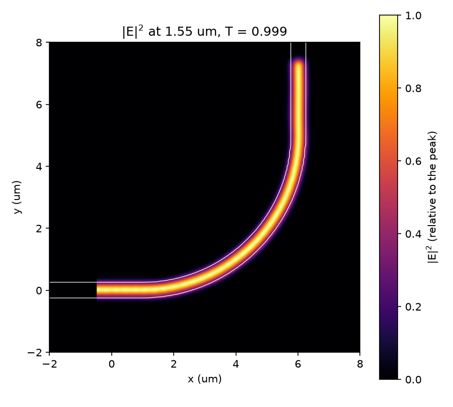

# Getting started: your first simulation

This page takes you from an empty file to a simulated 90° silicon waveguide bend: a transmission value, a field image,
and the result open in the viewer. It is one script, [`examples/waveguide_bend.py`](https://github.com/Sephiram591/bifrost/blob/main/examples/waveguide_bend.py),
explained step by step. [Install bifrost](installation.md) first, and run the script on a GPU if you have one.

The device is a 500 nm wide, 220 nm thick silicon strip in silica. It is gdsfactory's `bend_circular` cell: a 5 µm radius circular arc that
turns left, with both ports extended straight to the edge of the simulation box. TE0 light at 1.55 µm is launched into the
extension of port `o1`, and we measure how much of it leaves port `o2` in TE0.

## Run it

Copy the complete script (it is [listed below](#the-complete-script)) into a file `waveguide_bend.py` and run it:

```bash
python waveguide_bend.py
```

You should see (the numbers are from an NVIDIA L40S; yours will differ slightly):

```text
transmission: 1.0008
wall time:    32.4 s (compilation included)
peak memory:  1.2 GiB on cuda:0
field image:  waveguide_bend_field.png
```

and the file `waveguide_bend_field.png` appears next to the script:



The light enters at the bottom left, follows the 90° turn and leaves at the top right. The transmission is the fraction of
the input TE0 power that comes out of `o2` in TE0: **1.0008**. A transmission a little above 1 is not gain: it is the
numerical error of the mode amplitudes at this grid, a few parts in a thousand, and it shrinks as the grid is refined (see
[Choosing the settings](#choosing-the-settings)). A bend this wide loses less than that error.

!!! note "How long it takes"
    On an NVIDIA L40S the script took **32 s** and a peak of **1.2 GiB** of GPU memory. The first
    run includes the time JAX needs to compile the solver: in one process the first simulation took 32.7 s and an identical second one 16.1 s, so about half of the first run is compilation. Without a GPU, try a coarser grid first
    (`--resolution 0.1` took 31 s on 4 CPU cores, with a transmission of 0.980). The introductory settings are chosen to be quick: they are not a
    convergence study (see [Choosing the settings](#choosing-the-settings)).

## The script, step by step

### 1. The component

A gdsfactory component is polygons plus ports, and you rarely draw them by hand: gdsfactory's parametric cells (pcells)
build one from a few parameters. `gf.components.bend_circular` makes a circular arc with a port at each end: `o1` faces
west (`orientation` 180°) and `o2` faces north (90°). The cell and the waveguide layer `gf.gpdk.LAYER.WG` come from the
generic PDK, which `gf.gpdk.PDK.activate()` loads. Any other pcell, or a component you built yourself, works the same way.

```python
--8<-- "examples/waveguide_bend.py:imports"

--8<-- "examples/waveguide_bend.py:parameters"

--8<-- "examples/waveguide_bend.py:component"
```

All lengths are in µm.

### 2. The layer stack and materials

A `LayerStack` says what each layer is made of and how thick it is. This one has a single level: the core, on the waveguide
layer, 0.22 µm thick, starting at `z = 0`. Two constant-index materials, the silicon core and the silica cladding, are all the
solver needs.

### 3. The device

`StackDevice.from_layer_stack` voxelizes the component through the stack. `background="clad"` fills everything the core
does not. `extend_ports` continues both ports straight out by 2.5 µm, so the guide runs through the absorbing boundary
instead of ending inside the simulation. `boundary_offset` sets the simulation box: the faces that hold a port stay put,
the others move out by 2.25 µm in x and y, and the box is 3.4 µm tall in z. The result is a 10 × 10 × 3.4 µm box.

```python
--8<-- "examples/waveguide_bend.py:stack"
```

!!! note "The box must be a whole number of cells"
    The grid spacing has to divide each side of the box evenly. 10 µm and 3.4 µm suit 50, 40, 25 and 20 nm cells; a
    side of 9.85 µm would not divide by 40 nm and fdtdx would stop with `Configured grid shape ... does not match
    simulation volume shape`.

### 4. Wavelength, grid, duration and boundaries

These are fdtdx's own objects, and fdtdx works in **meters**, so the lengths from the script (µm) are multiplied by
`1e-6` where they enter. `SimulationConfig` takes the simulated time and the grid. The 1.55 µm wave is `WaveCharacter`. The
source is a pulse 5 % wide in frequency, which ramps up smoothly. The absorbing boundary (PML) is 1 µm thick and is placed
later, inside each face of the box.

```python
--8<-- "examples/waveguide_bend.py:settings"
```

### 5. Source and monitors

Everything that is placed on a port goes through the device: `create_mode_plane_source_at` makes a source that launches
TE0 (`mode_index=0, filter_pol="te"`) 1 µm outside the port, in the straight extension (a negative `port_offset` moves a
plane out of the device). `create_mode_overlap_detector_at`
makes monitors that report how much TE0 passes a plane: one 0.5 µm outside `o1` (counting the mode that travels *into*
the bend) and one 0.5 µm outside `o2`. Each plane extends 0.5 wavelengths past the guide's width and 0.3 past its height, on each side
(`PLANE_PADDING`). A `PhasorDetector` records the electric field on the xy plane through the middle of the core, at the
wavelength, and a `FieldDetector` records the same plane at 40 time steps: a movie of the pulse, which the viewer can
play.

```python
--8<-- "examples/waveguide_bend.py:objects"
```

### 6. Place, apply and run

`fdtdx.place_objects` fits everything onto the grid. The stack is written into the permittivity with `bf.apply_stack`
(where a plain fdtdx simulation calls `fdtdx.apply_params`), and `fdtdx.run_fdtd` runs the solver.

```python
--8<-- "examples/waveguide_bend.py:run"
```

### 7. Transmission

Each mode monitor stores a complex *amplitude*: how much of TE0 overlaps the plane's field. The input monitor sits in the
straight extension, where the bend has not yet had any effect, so its amplitude is the TE0 amplitude that went in. The
output monitor's amplitude is what came out. The ratio of their squared magnitudes is the transmission, which is
**normalized**: it needs no separate reference simulation, because both monitors use the same mode of the same guide. It
counts only light that leaves in TE0, so light that scatters into other modes or into the cladding is lost. It also does
not count light reflected back, which the input monitor (direction `"in"`) does not see.

```python
--8<-- "examples/waveguide_bend.py:results"
```

### 8. The field image and the viewer

`plot_field` saves the figure above: |E|² on the xy plane through the middle of the core, with the guide's outline from the
permittivity. To explore the result in 3D, load it into the viewer. In a Jupyter or marimo cell, end the cell with the
viewer to display it:

```python
--8<-- "examples/waveguide_bend.py:viewer"
```

The viewer opens on the Layout tab; the **Result** tab shows the field monitors on their planes, the 2D cross-sections, and
the movie. You can try exactly this result, precomputed, in the [live demo](guide/viewer.md#live-demo).

## The complete script

```python
--8<-- "examples/waveguide_bend.py"
```

## Choosing the settings

These runs of the same script on an NVIDIA L40S show what the grid costs and buys. The transmission moves by less than 0.2 %
across these grids, which is why the script uses 40 nm; a finer grid would matter for a more sensitive device. This is a short study to choose the
setting, not a convergence study.

| Grid cell | Transmission | Wall time | Peak GPU memory |
|---|---|---|---|
| 50 nm | 1.0012 | 24 s | 0.7 GiB |
| 40 nm (the script's default) | 1.0008 | 32 s | 1.2 GiB |
| 25 nm | 0.9998 | 106 s | 4.6 GiB |
| 20 nm | 0.9994 | 227 s | 8.7 GiB |

A run 1.5 times as long (600 fs) gives the same transmission to four digits at 25 nm (0.9998), so 400 fs is enough time for the pulse to cross the device and ring down.

## Troubleshooting

- **The run takes forever, or `jax.devices()` shows only a CPU.** JAX found no GPU. See [GPU setup](installation.md#gpu-setup).
  A CPU works but is much slower than a GPU; coarsen the grid (`--resolution 0.1`) to try the script.
- **The first run is slow but later ones are fast.** The first call compiles the solver for this grid size; that time is in
  the wall-clock figure above. Changing the box or the grid compiles again.
- **`RESOURCE_EXHAUSTED` or an out-of-memory error.** The grid is too fine for the GPU's memory: memory grows with the cube of the
  refinement (see the table). Use a coarser `--resolution`, or a smaller box.
- **`Configured grid shape ... does not match simulation volume shape`.** The box is not a whole number of cells; see
  [step 3](#3-the-device).
- **The viewer shows nothing in a plain script.** The viewer is a notebook widget. Run the code in Jupyter or marimo and end
  the cell with the viewer, or look at the [live demo](guide/viewer.md#live-demo).
- **The transmission is 0 or absurd.** Check the units (fdtdx wants meters: `1e-6`), that the source is not inside the
  PML, and that each plane lies inside the box. See [Simulation setup and ports](guide/simulation-setup.md).

## Next

- [Simulation setup and ports](guide/simulation-setup.md): sources, monitors and the run, in detail.
- [Results and field monitors](guide/results.md): reading what the monitors record.
- [Gradients and inverse design](guide/gradients.md): differentiate the transmission with respect to the radius or width.
