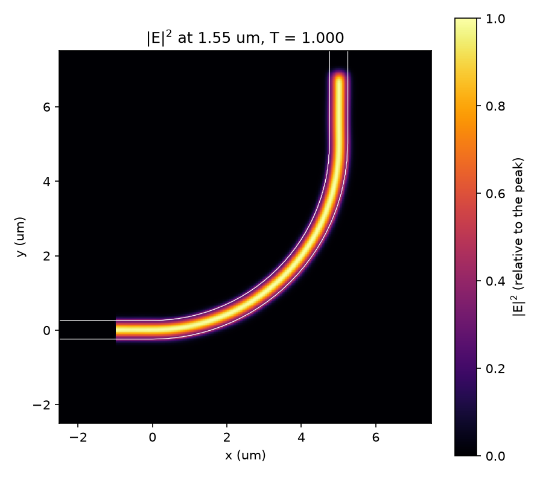

# Getting started: your first simulation

Here we simulate a 90° silicon waveguide bend: we compute the
transmission value, plot the field, and open the result in the viewer.

## Run it

You can download the [complete script](https://github.com/Sephiram591/bifrost/blob/main/examples/waveguide_bend.py) as `waveguide_bend.py` and run it:

```bash
python waveguide_bend.py
```

Output on an NVIDIA L40S (yours will differ slightly):

```text
transmission: 0.9998
wall time:    68.0 s (compilation included)
peak memory:  2.9 GiB on cuda:0
field image:  waveguide_bend_field.png
```



A bend this wide loses only a few parts in ten thousand—comparable to the numerical error of the mode amplitudes on the
grid, which can put coarser grids slightly above 1 without gain (see [Choosing the settings](#choosing-the-settings)).

## The script, step by step

### 1. The component

`gf.components.bend_circular`, a gdsfactory parametric cell, makes a circular arc with a port at each end: `o1` faces
west (`orientation` 180°) and `o2` faces north (90°). The cell and the waveguide layer `gf.gpdk.LAYER.WG` come from the
generic PDK, which `gf.gpdk.PDK.activate()` loads. Any other cell, or a component you built yourself, works the same
way. Lengths are in µm.

```python
--8<-- "examples/waveguide_bend.py:imports"

--8<-- "examples/waveguide_bend.py:parameters"

--8<-- "examples/waveguide_bend.py:component"
```

### 2. The layer stack and materials

The `LayerStack` has one level: the core, on the waveguide layer, 0.22 µm thick from `z = 0`. The materials are
constant-index silicon for the core and silica for the cladding.

```python
--8<-- "examples/waveguide_bend.py:layerstack"
```

### 3. The device

`StackDevice.from_layer_stack` voxelizes the component through the stack. `background="clad"` fills everything the core
does not. `extend_ports` continues both ports straight out by 2.5 µm, so the guide runs through the absorbing boundary
instead of ending inside the simulation. `boundary_offset` sets the simulation size by offsetting each face from the boundary of the GDS cell and the zrange_layers: the faces that hold a port stay put, the others
move out by 2.25 µm in x and y, and the box is 3.4 µm tall, 10 × 10 × 3.4 µm in all.

```python
--8<-- "examples/waveguide_bend.py:stack"
```

### 4. Wavelength, grid, duration and boundaries

`bf.mesh` builds a graded grid (20 points per local wavelength by default) and a 1 µm absorbing boundary (PML, placed
later inside each face of the box) from µm inputs. fdtdx objects work in **meters**: `WAVELENGTH` is multiplied by
`1e-6` where it enters `WaveCharacter`, and `SimulationConfig` takes the simulated time and `mesh.grid`.

```python
--8<-- "examples/waveguide_bend.py:settings"
```

### 5. Source and monitors

`create_mode_plane_source_at` launches TE0
(`mode_index=0, filter_pol="te"`) 1 µm outside `o1`, in the straight extension (a negative `port_offset` moves a plane
out of the device). `create_mode_overlap_detector_at` makes monitors of the TE0 that passes a plane: one 0.5 µm outside
`o1`, counting the mode travelling *into* the bend, and one 0.5 µm outside `o2`. Each plane extends 0.5 wavelengths past
the guide's width and 0.3 past its height on each side (`PLANE_PADDING`). A `PhasorDetector` records the electric field
at the wavelength on the xy plane through the middle of the core, and a `FieldDetector` records the same plane at 40
time steps: a movie of the pulse for the viewer.

```python
--8<-- "examples/waveguide_bend.py:objects"
```

### 6. Place, apply and run

`fdtdx.place_objects` fits everything onto the grid, `bf.apply_stack` writes the stack into the permittivity (where a
plain fdtdx simulation calls `fdtdx.apply_params`), and `fdtdx.run_fdtd` runs the solver.

```python
--8<-- "examples/waveguide_bend.py:run"
```

### 7. Transmission

Each mode monitor stores a complex *amplitude*: the overlap of TE0 with the plane's field. The input monitor sits in the
straight extension, before the bend has any effect, so it measures what went in; the output monitor measures what came
out. The ratio of their squared magnitudes is the transmission. It is **normalized** without a reference simulation,
because both monitors use the same mode of the same guide. It counts only light that leaves in TE0 (light scattered into
other modes or the cladding is lost), and not light reflected back, which the input monitor (direction `"in"`) does not
see.

```python
--8<-- "examples/waveguide_bend.py:results"
```

### 8. The field image and the viewer

`plot_field` saves the figure above, with the guide's outline from the permittivity. To explore the result in 3D, load
it into the viewer (in Jupyter or marimo, end the cell with the viewer):

```python
--8<-- "examples/waveguide_bend.py:viewer"
```

The viewer opens on the Layout tab; the **Result** tab shows the field monitors on their planes, the 2D cross-sections
and the movie. This exact result, precomputed, is in the [Widget Demo](live-demo.md) (and the standalone [Explorer demo](demo/index.html)).

## The complete script

```python
--8<-- "examples/waveguide_bend.py"
```

## Choosing the settings

The table below compares the same script on an NVIDIA L40S across four adaptive mesh densities, each run in a fresh process (`scripts/bend_sweep.py` reproduces the table). Because the transmission moves by less than 0.2 %, the script uses `ppw = 20` (`bf.mesh`'s default); a more sensitive device would need a finer grid.

| Points per wavelength (ppw) | Grid cells | Transmission | Wall time | Peak GPU memory |
|---|---|---|---|---|
| 12 | 3.05M | 1.0009 | 26 s | 1.1 GiB |
| 16 | 7.02M | 1.0000 | 40 s | 1.8 GiB |
| 20 (the script's default) | 13.46M | 0.9998 | 68 s | 2.9 GiB |
| 24 | 23.03M | 0.9993 | 124 s | 5.0 GiB |

A run 1.5 times as long (600 fs) gives the same transmission to four digits at `ppw = 24` (0.9993), so 400 fs is enough
for the pulse to cross the device and ring down.

## Troubleshooting

- **The run takes forever, or `jax.devices()` shows only a CPU.** JAX found no accelerator: see
  [JAX setup](installation.md#jax-setup). On a CPU, coarsen the mesh (`--ppw 10`) to try the script.
- **The first run is slow but later ones are fast.** The first call compiles the solver for this grid size. Changing the
  box or the grid compiles again.
- **`RESOURCE_EXHAUSTED` or an out-of-memory error.** The grid is too fine for the accelerator's memory, which grows with
  `--ppw` (see the table). Lower `--ppw` or use a smaller box.
- **The viewer shows nothing in a plain script.** The viewer is a notebook widget: run the code in Jupyter or marimo and
  end the cell with the viewer, or look at the [Widget Demo](live-demo.md) or standalone [Explorer demo](demo/index.html).
- **The transmission is 0 or absurd.** Check the units (fdtdx wants meters: `1e-6`), that the source is not inside the
  PML, and that each plane lies inside the box. See [Simulation setup and ports](guide/simulation-setup.md).

## Next

- [Simulation setup and ports](guide/simulation-setup.md): sources, monitors and the run, in detail.
- [Adaptive meshing](guide/adaptive-meshing.md): how automatic non-uniform meshing cuts cell count and memory at fixed accuracy.
- [Results and field monitors](guide/results.md): reading what the monitors record.
- [Gradients](guide/gradients.md): differentiate a result with respect to the geometry, through the simulation.
- [Inverse design](guide/inverse-design.md): optimize the width profile of a tight bend for transmission.
