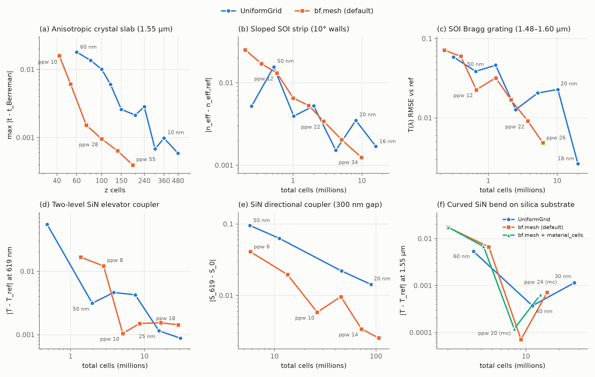

# Adaptive meshing

`bf.mesh` builds a non-uniform tensor-product grid once from the device's `StackDevice`, the simulated wavelength band, and an optional statement of where parameters may move (`Refine`). Across six photonic simulations—covering 1D anisotropic crystals, 10° sloped waveguides, Bragg gratings, multi-level taper couplers, directional couplers, and curved bends on substrates—`bf.mesh` cuts total grid cells by **2× to 4.8×** at matched accuracy and cuts discretization error by **2× to 10×** at matched cell count compared to `fdtdx.core.grid.UniformGrid`.

## Accuracy per grid cell across simulations

All benchmarks below use bifrost's default Green's-theorem voxelizer (`voxelizer="greens"`) and Kottke subpixel homogenization (`averaging="subpixel"`, or `"subpixel_full"` on the rotated anisotropic crystal slab), with float32 fields on an NVIDIA L40S (`benchmarks/meshing/accuracy_per_cell.py`).



Each panel sweeps grid resolution (`UniformGrid` cell size in nm, `bf.mesh` points per wavelength `ppw`) against an independent or fine-grid reference:

- **(a) Rotated anisotropic crystal slab (1.55 µm, `averaging="subpixel_full"`).** A 137 nm slab of `eps = R(25°) diag(9, 12, 14) R(25°)^T + 0.8 (x z^T + z x^T)` in air at normal incidence against the exact 4 × 4 Berreman transfer-matrix Jones transmission (`benchmarks/subpixel/berreman.py`). From `ppw=10` upward (4+ PML cells), `bf.mesh` tracks the `O(N_z^-2)` slope shifted left by **3.5×–3.6×**: `mesh-28` (`100` z cells) reaches `9.57e-4` error against `uniform-10`'s `9.80e-4` (`360` cells), and `mesh-55` (`190` cells) reaches `3.95e-4`, outperforming `uniform-7.5` (`480` cells, `5.91e-4`). At `ppw=6` and `ppw=8` (not shown), `pml=0.6` µm holds only 3–4 coarse air cells and PML reflection limits accuracy (`t_error = 4.87e-2` and `3.16e-2`); use `ppw >= 10` with thin PMLs.
- **(b) Sloped SOI strip waveguide (10° sidewalls, 1.55 µm).** A 500 × 220 nm silicon strip in silica (6.40 × 3.20 × 3.20 µm box), comparing the mode solver's `neff_mode` against the `tidy3d` continuum extrapolation (`2.381043` from 10, 5, and 2.5 nm solves in `benchmarks/rectilinear/results/guide_tidy3d_reference.json`). On uniform grids, sub-cell boundary crossings swing `neff_mode` by up to `1.56e-2` (`uniform-50`) and flip the error sign between 25 nm and 16 nm; `bf.mesh` centers both core faces mid-cell and converges monotonically (`2.4062` at `ppw=8` to `2.3823` at `ppw=34`). `mesh-22` (`2.80M` cells, `3.87 s`, `1.46 GB`) matches `uniform-20` (`8.19M` cells, `16.73 s`, `2.48 GB`) to `9e-5` in `neff_mode` and `2e-5` in `neff_fdtd` with **2.9× fewer cells** and **4.3× shorter runtime**.
- **(c) Broadband SOI sidewall Bragg grating (1.48–1.60 µm).** A 10-period corrugated silicon waveguide (`Lambda = 320 nm`, widths `560 / 440 nm`, 8.00 × 3.20 × 3.20 µm box), measuring broadband `T(lambda)` spectral RMSE across 31 wavelengths against `uniform-12.5` (`41.94M` cells). `mesh-18` (`2.13M` cells, `4.48 s`) beats both `uniform-25` (`5.24M` cells, `13.22 s`) and `uniform-20` (`10.24M` cells, `48.98 s`), a **4.8× cell reduction** and **10.9× speedup** over `uniform-20`. `mesh-26` (`6.22M` cells, `23.50 s`) cuts spectral RMSE to `4.84e-3`, **4.7× lower error** than `uniform-20`.
- **(d) Two-level SiN adiabatic elevator coupler (619 nm).** Upper (`190 nm`) and lower (`110 nm`) SiN tapers (`650 -> 50 nm`) separated vertically by a `100 nm` oxide gap (`overlap = 3.80 um`, 19.20 × 4.00 × 3.20 µm box), measuring TE0 transfer `T` against `uniform-16` (`60.00M` cells, `T = 0.53553`). `mesh-10` (`5.09M` cells, `10.12 s`, `1.29 GB`) hits `T = 0.53447` (`1.05e-3` from `uniform-16`), matching `uniform-25` (`15.73M` cells, `50.59 s`, `3.98 GB`, `1.15e-3`) with **3.1× fewer cells, 3.1× less memory, and 5.0× faster runtime**, while achieving **4.1× lower error** than `uniform-32` (`7.50M` cells). Finer adaptive meshes (`mesh-12` to `mesh-18`, `8.6M`–`28.6M` cells) plateau within `1.1e-4` of each other at `T = 0.5340–0.5341` because all four SiN interfaces sit mid-cell, whereas `uniform-32..16` still drift downward (`0.5398 -> 0.5367 -> 0.5364 -> 0.5355`) with horizontal gap walls on cell edges.
- **(e) Broadband SiN directional coupler (538–728 nm, 300 nm gap).** Two 400 × 200 nm SiN waveguides in oxide (43 × 6.4 × 2.6 µm box), measuring the 619 nm splitting ratio against the joint uniform continuum fit `S0 = 0.3558` (`benchmarks/rectilinear/README.md`). At matched cell count (`5.79M` vs `5.72M`), `mesh-6` cuts error **2.3×** below `uniform-50` (`4.10e-2` vs `9.55e-2`). `mesh-10` (`26.34M` cells, `78.29 s`) reaches `5.85e-3` error—**2.4× more accurate** than `uniform-20` (`89.44M` cells, `344.05 s`, `1.43e-2`) with **3.4× fewer cells** and **4.4× shorter runtime**.
- **(f) Curved SiN bend on a full-wafer silica substrate (1.55 µm).** A 7 µm radius 90° air-clad SiN bend on `WAFER` silica (12.36 × 12.36 × 4.80 µm box), measuring TE0 transmission against `uniform-24` (`53.05M` cells, `T = 0.55828`). Because the bend spans 63 % of both lateral axes and the silica level spans the entire plane, coarsening silica via `Refine(material_cells=...)` reduces cells by 13 % (`meshsub-20`: `7.87M`, `18.18 s`, `2.37 GB`) relative to default `bf.mesh` (`9.05M`, `23.67 s`, `5.24 GB`) and by 31 % relative to `uniform-40` (`11.46M`, `29.97 s`, `6.71 GB`). `meshsub-24` (`13.53M` cells, `3.74 GB`, `42.66 s`) has nearly half the error of `uniform-30` (`27.16M` cells, `16.20 GB`, `92.40 s`) at **2.0× fewer cells, 4.3× less peak GPU memory, and 2.2× faster runtime**; `meshclad-40-80` adds a `0.45` µm optimization dilation around the moving bend and still uses 35 % fewer cells (`7.45M`) and **2.9× less memory** (`2.28 GB`) than `uniform-40` (`T` agrees within `1.9e-5`).

### Summary at matched accuracy

| Simulation (reference) | Uniform grid | Uniform cells / err | `bf.mesh` grid | `bf.mesh` cells / err | Reduction (cells / time) |
| --- | --- | --- | --- | --- | --- |
| Anisotropic slab (Berreman) | `uniform-10` | `360 z` / `9.80e-4` | `mesh-28` | `100 z` / `9.57e-4` | **3.6×** cells |
| Sloped SOI strip (`tidy3d`) | `uniform-20` | `8.19M` / `3.50e-3` | `mesh-22` | `2.80M` / `3.42e-3` | **2.9×** cells, **4.3×** faster |
| SOI Bragg grating (`12.5 nm`) | `uniform-20` | `10.24M` / `2.28e-2` | `mesh-18` | `2.13M` / `1.69e-2` | **4.8×** cells, **10.9×** faster |
| Elevator coupler (`16 nm`) | `uniform-25` | `15.73M` / `1.15e-3` | `mesh-10` | `5.09M` / `1.05e-3` | **3.1×** cells, **5.0×** faster |
| Directional coupler (`S0`) | `uniform-20` | `89.44M` / `1.43e-2` | `mesh-10` | `26.34M` / `5.85e-3` | **3.4×** cells, **4.4×** faster |
| SiN bend (`24 nm`) | `uniform-30` | `27.16M` / `1.14e-3` | `meshsub-24` | `13.53M` / `6.40e-4` | **2.0×** cells, **2.2×** faster |

## Why adaptive meshing wins per cell

Three mechanisms in `bf.mesh` work together so fewer cells achieve equal or lower error:

1. **Material-scaled spacing plus `3l` evanescent tails (`ppw`, `global_dilation`, `global_z_padding`).** Every region asks for cells no wider than `lambda / (n ppw)`, grading smoothly outward with neighbor ratio at most `growth=1.25`. Crucially, fine cells extend past every high-index boundary into lower-index cladding by `3` evanescent decay lengths `l = lambda_max / (2 pi sqrt(n_high^2 - n_low^2))` by default (`global_dilation=3.0`, `global_z_padding=3.0`). On the sloped SOI waveguide (`benchmarks/rectilinear/results/guide_tails.json`), stopping fine cells right at the silicon boundary (`0` decay lengths) loses `-3.3e-3` in `neff`—as much as doubling the uniform cell size—whereas `1`, `2`, and `3` decay lengths cut that error to `-5.8e-4`, `-1.4e-4`, and `-3.7e-5` (with only 31 % of the uniform 20 nm grid's cells at `3`).
2. **Planar interfaces centered mid-cell (`center_faces=True`).** In Yee grids, horizontal material interfaces on primal cell edges coincide with `Ex` and `Ey` dual-cell faces, creating an asymmetric `O(hz^2)` averaging error that can be three times larger than placing those interfaces at exact cell midpoints (`0.500` of a z cell). On the directional coupler (`benchmarks/rectilinear/README.md`), `center_faces=True` cuts error up to **2.6×** at fixed `ppw` (e.g., `8.6e-3` down to `3.3e-3` at `ppw=17`) and keeps `neff_mode` monotone on the sloped waveguide instead of jumping across sub-cell boundary crossings.
3. **Automatic resolution of thin tips and narrow gaps (`feature_cells=1.5`).** KLayout width and space checks on each level's starting geometry automatically target at most `w / 1.5` locally around narrow tapers and gaps, such as the elevator coupler's 50 nm taper tips (`min_dx = 33.3 nm` even at `ppw=6` and `ppw=8`), without refining the rest of the cladding or waveguide bulk. Use `min_cell=` when a sub-wavelength film or sliver would otherwise force an unnecessarily small time step.

## Practical trade-offs and tuning

- **Memory savings are unconditional; time-step savings follow GPU saturation.** Because the smallest cell anywhere in the domain sets the global CFL time step `dt`, grading saves **cells, field memory, and adjoint-checkpoint memory** proportionally while keeping roughly the same number of time steps as a uniform grid at the core spacing. On small domains below ~2–3M cells (`aniso_slab`, coarse `sloped_guide`), kernel launch latency dominates and wall times are similar; once grids exceed a few million cells and saturate GPU compute (`soi_bragg`, `elevator_coupler`, `directional_coupler`, `sin_bend`), wall time drops nearly in proportion to cell count (4×–11× faster at matched accuracy).
- **Coarsen full-wafer substrates on tensor-product grids with `Refine.material_cells`.** Because a rectilinear mesh is a tensor product of 1D axis edge arrays, each coordinate takes the finest target anywhere in its cross-sectional plane. A `WAFER` substrate or uniform cladding spanning all x and y planes caps the coarse lateral spacing everywhere at `lambda / (n_sub ppw)`. Coarsening low-contrast substrates with `material_cells` to ~13 cells per wavelength recovers lateral grading in margins and PMLs without hurting accuracy, and combines directly with optimization `dilation`:

```python
import fdtdx
import gdsfactory as gf
from gdsfactory.technology import LayerLevel, LayerStack
import bifrost as bf

gf.gpdk.PDK.activate()
component = gf.components.bend_circular(radius=5, width=0.5)
layer_stack = LayerStack(
    layers={
        "box": LayerLevel(layer="WAFER", zmin=-3.0, thickness=3.0, material="silica", mesh_order=9),
        "core": LayerLevel(layer=gf.gpdk.LAYER.WG, zmin=0.0, thickness=0.22, material="si", mesh_order=1),
    }
)
materials = {
    "si": fdtdx.Material(permittivity=3.48**2),
    "silica": fdtdx.Material(permittivity=1.444**2),
    "air": fdtdx.Material(permittivity=1.0),
}
stack = bf.StackDevice.from_layer_stack(
    component, layer_stack, materials, background="air", zrange_layers=["core"],
    extend_ports=(("o1", 2.0), ("o2", 2.0)), boundary_offset=(1.5, 0.0, 0.0, -1.5, 1.4, -1.4), name="stack",
)

# 1.55 um band; allow 0.35 um boundary motion during inverse design while coarsening the wafer box
mesh = bf.mesh(
    stack, (1.50, 1.60), ppw=18,
    refine=bf.Refine(dilation={"WG": 0.35}, material_cells={"silica": 0.08}),
)
config = stack.get_simulation_config(time=300e-15, grid=mesh.grid)
source, src_placing = stack.create_mode_plane_source_at(
    "o1", (0.5, 0.5), wave_character=fdtdx.WaveCharacter(wavelength=1.55e-6), grid=config,
)
```

For full placement rules (`grid=config` on port monitors and `mesh.boundary`), see [Simulation setup and ports](simulation-setup.md#automatic-meshing); for every parameter of `mesh`, `Refine`, and `CoarseVertices`, see [`bf.meshing`](../api/meshing.md).
