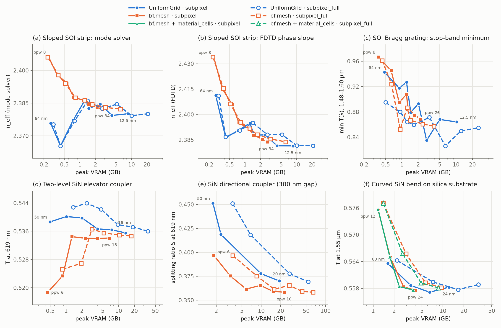
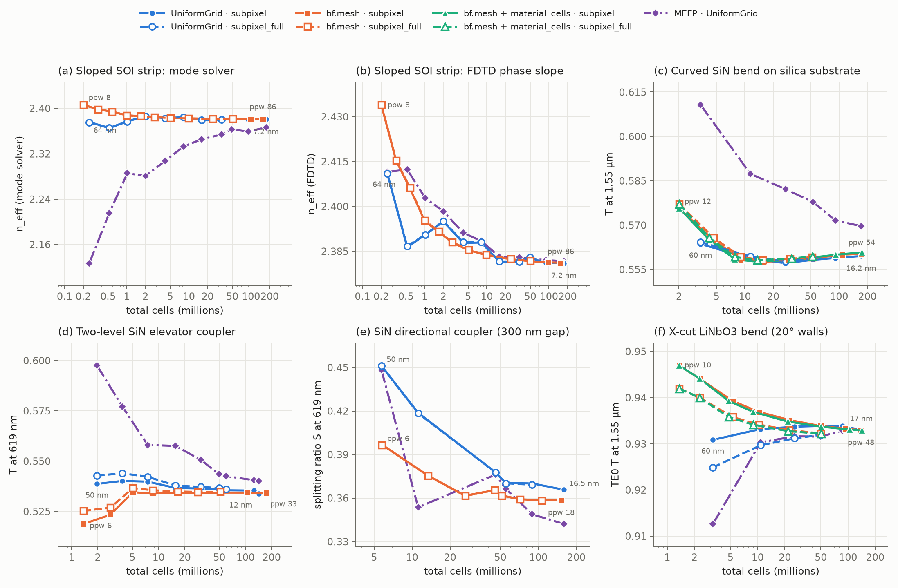

# Convergence Testing

It is vital to ensure that simulation results are accurate enough before sending them out to fab. In order to apply computation where it matters most, bifrost leverages adaptive meshing by default to generate smaller cells in high index materials and larger cells in low index materials. `bf.mesh(stack, wavelength, ppw=..., refine=...)` builds a non-uniform grid once from a `StackDevice`, a wavelength or `(min, max)` wavelength band in µm, a target grid density (`ppw`, points per local wavelength), and an optional `bf.Refine` configuration specifying where parameters or vertices may move (this helps avoid the need for remeshing during optimization). It returns `mesh.grid` for `stack.get_simulation_config(...)` and `mesh.boundary` for `fdtdx.boundary_objects_from_config(...)`.

Across photonic simulations—covering 1D anisotropic crystals, 10° sloped waveguides, curved SiN bends on substrates, multi-level taper couplers, directional couplers, and X-cut LiNbO₃ bends with 20° sidewalls—`bf.mesh` cuts total grid cells by **1.7× to 3.6×** (and up to **6×–12×** at tighter fine-grid tolerances), peak GPU memory by **1.7× to 3.1×**, and runtime by **1.7× to 5.0×** (up to **9.5×–28.6×** at finer tolerances) at matched accuracy compared to `fdtdx.core.grid.UniformGrid`. Native-geometry uniform-grid sweeps in MEEP (`mp.Prism`/`mp.Block`, 16 MPI CPU cores) confirm the same continuum limits while taking **3.0× to 8.1×** longer than `bifrost` at identical uniform cell counts (and **26× to 187×** longer than `bf.mesh` on one GPU).

## Convergence against peak VRAM

The benchmarks below run in `float32` precision under both Kottke subpixel homogenization modes: `averaging="subpixel"` and `averaging="subpixel_full"`, compared in [Diagonal vs full-tensor averaging](#diagonal-vs-full-tensor-averaging). We also plot independent uniform-grid MEEP reference simulations (`benchmarks/meshing/meep_uniform.py`) built strictly from native `mp.Prism` and `mp.Block` primitives with `mp.Medium` and run across 16 MPI CPU cores (8 cores for the 1D crystal slab) using `float64` precision. Because MEEP executes in CPU RAM, each MEEP point is placed on the VRAM plot at an **equivalent GPU VRAM** (`equiv_peak_gb`) linearly interpolated at the same `total_cells` from `bifrost`'s `UniformGrid` (`averaging="subpixel"`) curve on that benchmark.



- **(a) Effective index of a sloped SOI strip waveguide: mode solver (10° sidewalls, 1.55 µm).** A 500 × 220 nm silicon strip in silica (6.40 × 3.20 × 3.20 µm box; `tidy3d` continuum reference `2.381043`). On `UniformGrid`, sub-cell boundary crossings cause `neff_mode` to swing non-monotonically (`2.3758` at 64 nm / 0.27 GB, `2.3654` at 50 nm, `2.3863` at 32 nm, `2.3845` at 20 nm / 2.48 GB, `2.3801` at 12.5 nm / 8.48 GB, and `2.3806` at 7.2 nm / 43.31 GB / 175.25M cells). `bf.mesh` centers both core faces mid-cell and converges monotonically from `2.4062` at `ppw=8` (0.25 GB) through `2.3845` (`ppw=22`, 1.46 GB) and `2.3816` (`ppw=46`, 5.70 GB) to `2.3809` at `ppw=86` (35.22 GB, 155.49M cells). MEEP's MPB port mode solver on the 10° prism slice approaches monotonically from below (`2.1273` at 64 nm to `2.3665` at 7.2 nm).
- **(b) Effective index of a sloped SOI strip waveguide: FDTD phase slope (10° sidewalls, 1.55 µm).** Unwrapped `Ey` phase slope (`neff_fdtd`) in the 3D FDTD run. `UniformGrid` steps non-monotonically (`2.4112` at 64 nm, `2.3863` at 50 nm, `2.3949` at 32 nm, `2.3879` at 20 nm in 2.48 GB / 8.19M cells / 16.73 s, `2.3814` at 12.5 nm in 8.48 GB, and `2.3810` at 7.2 nm in 43.31 GB / 1074.43 s), whereas `bf.mesh` decreases smoothly from `2.4338` at `ppw=8` to `2.3879` at `ppw=22` (1.46 GB, 2.80M cells, 3.87 s—matching 20 nm `UniformGrid` in both `neff_mode` within 9e-5 and `neff_fdtd` within 2e-5 with **1.7× less VRAM**, **2.9× fewer cells**, and **4.3× shorter runtime**) and reaches `2.3812` at `ppw=86` (35.22 GB, 155.49M cells). MEEP's FDTD phase slope converges from `2.4115` (64 nm) through `2.3884` (20 nm, 90.22 s) to `2.3817` at 7.2 nm (43.31 GB equiv. VRAM, 3783.68 s).
- **(c) Transmission of a curved SiN bend on a full-wafer silica substrate (1.55 µm).** A 7 µm radius 90° air-clad SiN bend (1.6 × 0.75 µm) on `WAFER` silica (12.36 × 12.36 × 4.80 µm box). Both `UniformGrid` (`0.5636` at 60 nm, `0.5586` at 40 nm, `0.5571` at 30 nm in 6.46 GB / 27.16M cells / 92.40 s, `0.5583` at 24 nm in 12.26 GB, and `0.5595` at 16.2 nm in 39.67 GB / 172.32M cells / 1073.19 s) and default `bf.mesh` (`0.5755` at `ppw=12`, `0.5583` at `ppw=20` in 2.73 GB / 9.05M cells / 23.67 s, `0.5576` at `ppw=24`, and `0.5603` at `ppw=54` in 39.62 GB / 173.87M cells) agree to ~8e-4 at the L40S ceiling. Coarsening the full-wafer silica level via `Refine(material_cells=...)` trims cells and VRAM (`ppw=20`: 2.37 GB, 7.87M cells, 18.18 s, `T = 0.5584`; `ppw=24`: 3.74 GB, 13.53M cells, 42.66 s, `T = 0.5576`, out to `ppw=57`: 39.73 GB, 175.15M cells, `T = 0.5608`)—matching 30 nm `UniformGrid` with **1.7× less VRAM**, **2.0× fewer cells**, and **2.2× faster runtime**. Adding a 0.45 µm optimization dilation around the moving bend (`Refine(dilation={"WG": 0.45}, material_cells={"silica": 0.08})` with 40 nm core cells) reaches `T = 0.5586` in 2.28 GB (7.45M cells, 16.44 s). MEEP's uniform grid descends more gradually across this curved bend (`0.6107` at 60 nm, `0.5778` at 24 nm, `0.5697` at 16.2 nm in 39.67 GB equiv. VRAM / 7980.49 s).
- **(d) Transmission of a two-level SiN adiabatic elevator coupler (619 nm).** Upper (190 nm) and lower (110 nm) SiN tapers (650 to 50 nm wide, 3.80 µm overlap, 19.20 × 4.00 × 3.20 µm box) separated vertically by a 100 nm oxide gap. With all four horizontal SiN interfaces centered mid-cell, `bf.mesh` reaches `T = 0.5345` at `ppw=10` (1.29 GB, 5.09M cells, 10.12 s) and plateaus within ~5e-4 across `ppw=12` (2.30 GB, `0.5340`) through `ppw=33` (39.36 GB, 172.81M cells, 1412.99 s, `0.5343`). By contrast, `UniformGrid` places the z = 0 gap wall on a cell edge and drifts slowly downward from `0.5402` at 40 nm through `0.5367` at 25 nm (3.98 GB, 15.73M cells, 50.59 s) and `0.5355` at 16 nm (13.66 GB, 60.00M cells) to `0.5338` at 12 nm (32.58 GB, 142.26M cells, 916.74 s), while MEEP descends from `0.5975` (50 nm) and `0.5576` (25 nm) to `0.5402` at 12 nm (32.58 GB equiv. VRAM, 2792.21 s).
- **(e) Splitting ratio of a broadband SiN directional coupler (538–728 nm, 300 nm gap).** Two 400 × 200 nm SiN waveguides in oxide (43 × 6.4 × 2.6 µm box), showing the 619 nm cross-splitting ratio `S = P_cross / (P_cross + P_through)` (continuum fit `S_0 = 0.3558`). `UniformGrid` descends from `0.4513` at 50 nm (1.78 GB) through `0.3778` at 25 nm (9.84 GB, 45.79M cells, 143.74 s) and `0.3701` at 20 nm (19.05 GB, 89.44M cells) to `0.3657` at 16.5 nm (33.98 GB, 159.76M cells, 745.90 s). `bf.mesh` reaches `0.3754` at `ppw=8` (3.29 GB, 13.43M cells, 31.87 s—**3.0× less VRAM**, **3.4× fewer cells**, **4.5× faster** than 25 nm `UniformGrid`), `0.3616` at `ppw=10` (5.84 GB, 26.34M cells, 78.29 s—already closer to `S_0` than 16.5 nm `UniformGrid` in **5.8× less VRAM**), `0.3583` at `ppw=16` (22.61 GB), and `0.3586` at `ppw=18` (32.04 GB, 151.87M cells, 767.02 s). MEEP crosses `0.3536` at 40 nm, rebounds to `0.3762` at 25 nm, and reaches `0.3488` (20 nm) and `0.3421` at 16.5 nm (33.98 GB equiv. VRAM, 4580.11 s).
- **(f) Transmission of X-cut LiNbO₃ bend with 20° sidewalls (1.55 µm).** A 7 µm radius 90° birefringent TFLN ridge (1.2 × 0.50 µm, `n_o = 2.211`, `n_e = 2.138`, diagonal permittivity `(n_o^2, n_e^2, n_o^2)` on `WAFER` silica in air, 12.00 × 12.00 × 4.80 µm box; see [Lithium niobate bend](../examples/linbo3-bend.md)). `TE0` enters seeing `n_e` (`n_eff ≈ 1.7815`), exits seeing `n_o` (`n_eff ≈ 1.8390`), and converts ~4.2 % into `TM0` (`T_tm0 ≈ 0.042`) on the 20° sloped walls. `bf.mesh` + `material_cells` converges monotonically from `0.9469` (`ppw=10`, 1.26 GB) through `0.9369` (`ppw=20`, 2.93 GB, 8.91M cells, 25.20 s), `0.9348` (`ppw=27`, 5.11 GB), and `0.9337` (`ppw=36`, 11.60 GB, 50.59M cells, 254.88 s) to `0.9330` (`ppw=48`, 31.72 GB, 139.18M cells) and `0.9329` (`ppw=51` + `material_cells`, 32.39 GB, 142.63M cells). `UniformGrid` rises from `0.9309` (60 nm) to a slight crest around `0.9339`–`0.9338` (24–20 nm, 11.62–19.86 GB) before settling to `0.9330` (`T_tm0 = 0.0421`) at 17 nm (32.31 GB, 140.56M cells, 837.81 s)—giving **1.7×** cell, VRAM, and runtime savings (`ppw=36` + `material_cells` vs 20 nm, narrower here because the 7 µm bend occupies ~85 % of both lateral axes in the compact 12 × 12 µm box). MEEP's native-Prism uniform grid converges from below (`0.9126` at 60 nm, `0.9316` at 24 nm, `0.9328` at 20 nm) to `0.9331` (`T_tm0 = 0.0419`) at 17 nm (32.31 GB equiv. VRAM, 6795.31 s), matching `bifrost` 17 nm within `8.3e-5` on `T` and `2.2e-4` on `T_tm0` while `bifrost` runs **8.1× faster** on one L40S than 16 CPU cores.
- **Baseline overhead vs linear per-cell scaling.** Below ~1–2M cells, XLA compilation workspaces and 2D port mode solves create a ~0.25–0.9 GB floor. Above a few million cells, peak VRAM scales linearly with cell count at **0.21–0.25 GB per million cells** under `"subpixel"` and **0.60–0.62 GB per million cells** under `"subpixel_full"`, so cell-count reductions translate directly into VRAM savings.
- **Horizontal separation of `"subpixel"` and `"subpixel_full"`.** Unlike the cell-count panels where both modes share the same x-coordinates, plotting against peak VRAM shifts the dashed `"subpixel_full"` curves rightward. On three of the five 3D devices—where `bf.mesh`'s 2.9×–3.4× cell reduction outpaces `"subpixel_full"`'s memory factor—`bf.mesh` with full-tensor `"subpixel_full"` uses **less peak VRAM than `UniformGrid` with diagonal `"subpixel"`** at matched accuracy: `8.52 GB` (`ppw=8`, `"subpixel_full"`) vs `9.84 GB` (25 nm, `"subpixel"`) on the directional coupler, `3.10 GB` vs `3.98 GB` on the elevator coupler, and `1.74 GB` vs `2.48 GB` on the sloped SOI strip.
<!-- 
### Peak VRAM at matched accuracy

| Simulation (metric) | `UniformGrid` (`subpixel`) | `bf.mesh` (`subpixel`) | Finest `UniformGrid` (`subpixel`) | Reduction (`subpixel` / `subpixel_full`) |
| --- | --- | --- | --- | --- |
| Sloped SOI strip (`n_eff,FDTD`) | 20 nm: 2.48 GB | `ppw=22`: 1.46 GB | 7.2 nm: 43.31 GB | **1.7×** / **3.0×** |
| Curved SiN bend (`T` at 1.55 µm) | 30 nm: 6.46 GB | `ppw=24` + `material_cells`: 3.74 GB | 16.2 nm: 39.67 GB | **1.7×** / **1.9×** |
| Elevator coupler (`T` at 619 nm) | 25 nm: 3.98 GB | `ppw=10`: 1.29 GB | 12 nm: 32.58 GB | **3.1×** / **3.1×** |
| Directional coupler (`S` at 619 nm) | 25 nm: 9.84 GB | `ppw=8`: 3.29 GB | 16.5 nm: 33.98 GB | **3.0×** / **3.2×** |
| X-cut LiNbO₃ bend (`T` at 1.55 µm) | 20 nm: 19.86 GB | `ppw=36` + `material_cells`: 11.60 GB | 17 nm: 32.31 GB | **1.7×** / **1.2×** |

*(Under `averaging="subpixel_full"`, the X-cut LiNbO₃ bend comparison pairs `ppw=27` + `material_cells` at 13.18 GB against 30 nm `UniformGrid` at 15.61 GB, since 20 nm exceeds 48 GB on L40S.)* -->

## Convergence against grid cell count

Plotting the same runs against total cell count places `averaging="subpixel"`, `averaging="subpixel_full"`, and `MEEP · UniformGrid` on a shared geometric axis from `0.2M` to `175M` cells:



The benchmark suite also tests a 1D rotated anisotropic crystal slab under `averaging="subpixel_full"` against the exact 4 × 4 Berreman transfer-matrix Jones transmission (`benchmarks/subpixel/berreman.py`), where `bf.mesh` at `ppw=28` (100 z cells, `9.57e-4` max `|t - t_Berreman|`) matches 10 nm `UniformGrid` (360 z cells, `9.80e-4` in `bifrost`, `9.96e-4` in MEEP) with **3.6× fewer cells**, and reaches `3.95e-4` at `ppw=55` (190 z cells vs `5.91e-4` / `6.01e-4` at 7.5 nm / 480 z cells). (Off-diagonal crystal permittivity tensors require `averaging="subpixel_full"`.)

<!-- ### Summary of simulated values

| Simulation (metric) | `UniformGrid` (cells / value) | `bf.mesh` (cells / value) | Finest `UniformGrid` (`bifrost` / MEEP) | Reduction (cells / time) |
| --- | --- | --- | --- | --- |
| Sloped SOI strip (`n_eff,FDTD`) | 20 nm: 8.19M / 2.3879 | `ppw=22`: 2.80M / 2.3879 | 7.2 nm (175.25M): 2.3810 / 2.3817 | **2.9×** cells, **4.3×** faster |
| Curved SiN bend (`T` at 1.55 µm) | 30 nm: 27.16M / 0.5571 | `ppw=24` + `material_cells`: 13.53M / 0.5576 | 16.2 nm (172.32M): 0.5595 / 0.5697 | **2.0×** cells, **2.2×** faster |
| Elevator coupler (`T` at 619 nm) | 25 nm: 15.73M / 0.5367 | `ppw=10`: 5.09M / 0.5345 | 12 nm (142.26M): 0.5338 / 0.5402 | **3.1×** cells, **5.0×** faster |
| Directional coupler (`S` at 619 nm) | 25 nm: 45.79M / 0.3778 | `ppw=8`: 13.43M / 0.3754 | 16.5 nm (159.76M): 0.3657 / 0.3421 | **3.4×** cells, **4.5×** faster |
| X-cut LiNbO₃ bend (`T` at 1.55 µm) | 20 nm: 86.40M / 0.9338 | `ppw=36` + `material_cells`: 50.59M / 0.9337 | 17 nm (140.56M): 0.9330 / 0.9331 | **1.7×** cells, **1.7×** faster | -->

## Diagonal vs full-tensor averaging

`averaging="subpixel"` writes the diagonal of each voxel's Kottke-averaged permittivity tensor. `averaging="subpixel_full"` also writes the off-diagonal entries produced by interfaces oblique to the grid and runs `fdtdx`'s fully anisotropic update throughout the simulation. In the benchmarks above (dashed lines and hollow markers), mode sources and monitors solve on the diagonal of the averaged tensor (since `tidy3d`'s mode solver requires `tidy3d_extras` for fully anisotropic media) while the 3D FDTD update uses the complete 3 × 3 tensor.

<!-- Shifts are `"subpixel_full"` minus `"subpixel"` on the same grid. Run-time and peak-memory ratios are medians (with ranges) over the grids where both modes ran on the same GPU type; peak memory ratios compare runs under JAX's BFC allocator (`XLA_PYTHON_CLIENT_PREALLOCATE=false`). -->

<!-- | Simulation (metric) | Shift, all grids | Shift, finest `UniformGrid` | Shift, finest `bf.mesh` | Run time, full / diagonal | Peak memory, full / diagonal |
| --- | --- | --- | --- | --- | --- |
| Anisotropic slab (Berreman error) | — (`"subpixel"` rejects off-diagonal permittivity) | — | — | — | — |
| Sloped SOI strip (`n_eff,FDTD`) | -1.3e-4 to +4.0e-4 | +9.0e-5 (11 nm) | +6.7e-5 (`ppw=59`) | 4.8× (2.1–6.7×) | 1.19× (0.92–2.70×) |
| Curved SiN bend (`T` at 1.55 µm) | +4.0e-4 to +1.5e-3 | +5.7e-4 (24 nm) | +4.0e-4 (`ppw=38` + `material_cells`) | 5.4× (2.3–7.3×) | 2.06× (0.51–2.65×) |
| Elevator coupler (`T` at 619 nm) | +3.8e-4 to +1.2e-2 | +5.2e-4 (16 nm) | +3.8e-4 (`ppw=22`) | 5.4× (2.4–7.3×) | 2.44× (1.89–2.77×) |
| Directional coupler (`S` at 619 nm) | -8.9e-4 to +3.4e-3 | -8.9e-4 (20 nm) | -2.3e-5 (`ppw=16`) | 6.5× (2.9–8.0×) | 2.76× (0.74–2.89×) |
| X-cut LiNbO₃ bend (`T` at 1.55 µm) | -2.4e-2 to -1.5e-3 | -1.9e-3 (24 nm) | -1.5e-3 (`ppw=36` + `material_cells`) | 5.1× (2.2–7.7×) | 1.89× (1.03–2.63×) | -->

- **When to choose `"subpixel"` vs `"subpixel_full"`.** Use the default `averaging="subpixel"` for isotropic and diagonally anisotropic devices: `"subpixel_full"` adds 4.8–6.5× median runtime and 1.2–2.8× median peak GPU memory across the full 3D FDTD update. Switch to `averaging="subpixel_full"` when materials carry off-diagonal permittivity entries (such as rotated crystals) or when off-diagonal coupling at sub-cell oblique corners matters.
<!-- - **Where the two modes differ.** The largest differences appear on coarse grids or oblique anisotropic walls: on the X-cut LiNbO₃ bend, rotated 20° curved birefringent sidewalls shift `T` by `-2.4e-2` at 120 nm down to `-1.5e-3` to `-1.9e-3` (`+1.4e-3` to `+1.8e-3` on `T_tm0`) on the finest L40S `"subpixel_full"` grids (~50M cells), and the elevator coupler's `T` shifts by `1.2e-2` at 80 nm down to `3.8e-4`–`5.2e-4` at 50M–60M cells. On smooth isotropic waveguides (`sloped_guide`, `sin_bend`, `directional_coupler`), shifts stay within `4e-4` to `9e-4` on fine uniform grids and `bf.mesh`.
- **Interface placement vs off-diagonal averaging.** `UniformGrid` keeps the same non-monotonic oscillations under `"subpixel_full"` (`n_eff,FDTD` on the sloped strip still steps `2.4110 → 2.3867 → 2.3951 → 2.3881`): where material interfaces fall within grid cells—which `bf.mesh` controls via `center_faces=True`—rather than omitted off-diagonal tensor entries drives those swings. `bf.mesh` achieves the same cell-count reductions under both modes:

### Summary of simulated values under `averaging="subpixel_full"`

| Simulation (metric) | `UniformGrid` (cells / value) | `bf.mesh` (cells / value) | Finest `UniformGrid` | Reduction (cells / time) |
| --- | --- | --- | --- | --- |
| Sloped SOI strip (`n_eff,FDTD`) | 20 nm: 8.19M / 2.3881 | `ppw=22`: 2.80M / 2.3881 | 11 nm (49.28M): 2.3830 | **2.9×** cells, **3.6×** faster |
| Curved SiN bend (`T` at 1.55 µm) | 30 nm: 27.16M / 0.5577 | `ppw=24` + `material_cells`: 13.53M / 0.5581 | 24 nm (53.05M): 0.5588 | **2.0×** cells, **2.4×** faster |
| Elevator coupler (`T` at 619 nm) | 25 nm: 15.73M / 0.5379 | `ppw=10`: 5.09M / 0.5366 | 16 nm (60.00M): 0.5361 | **3.1×** cells, **4.0×** faster |
| Directional coupler (`S` at 619 nm) | 25 nm: 45.79M / 0.3777 | `ppw=8`: 13.43M / 0.3753 | 20 nm (89.44M): 0.3692 | **3.4×** cells, **7.0×** faster |
| X-cut LiNbO₃ bend (`T` at 1.55 µm) | 30 nm: 25.60M / 0.9312 | `ppw=27` + `material_cells`: 21.65M / 0.9327 | 24 nm (50.00M): 0.9319 | **1.2×** cells, **1.1×** faster | -->

## Why adaptive meshing wins per cell

Three mechanisms in `bf.mesh` work together so fewer cells achieve equal or lower error:

1. **Material-scaled spacing plus `3l` evanescent tails (`ppw`, `global_dilation`, `global_z_padding`).** Every region asks for cells no wider than `lambda / (n ppw)`, grading smoothly outward with neighbor ratio at most `growth=1.25`. Fine cells extend past every high-index boundary into lower-index cladding by `3` evanescent decay lengths `l = lambda_max / (2 pi sqrt(n_high^2 - n_low^2))` by default (`global_dilation=3.0`, `global_z_padding=3.0`). On the sloped SOI waveguide, stopping fine cells right at the silicon boundary (0 decay lengths) loses -3.3e-3 in `neff`—as much as doubling the uniform cell size—whereas 1, 2, and 3 decay lengths reduce that error to -5.8e-4, -1.4e-4, and -3.7e-5 (using only 31 % of the 20 nm uniform grid's cells at `3l`).
2. **Planar interfaces centered mid-cell (`center_faces=True`).** In Yee grids, horizontal material interfaces on primal cell edges coincide with `Ex` and `Ey` dual-cell faces, creating an asymmetric O(hz^2) averaging error that can be three times larger than placing those interfaces at exact cell midpoints (0.500 of a z cell). On the directional coupler, `center_faces=True` cuts error up to **2.6×** at fixed `ppw` (for example, 8.6e-3 down to 3.3e-3 at `ppw=17`) and keeps `neff_mode` monotone on the sloped waveguide instead of jumping across sub-cell boundary crossings.
3. **Automatic resolution of thin tips and narrow gaps (`feature_cells=1.5`).** KLayout width and space checks on each level's starting geometry automatically target at most `w / 1.5` locally around narrow tapers and gaps, such as the elevator coupler's 50 nm taper tips (producing 33.3 nm minimum spacing even at `ppw=6` and `ppw=8`), without refining the rest of the cladding or waveguide bulk. Use `min_cell=` when a sub-wavelength film or sliver would otherwise force an unnecessarily small time step.

## Practical trade-offs and tuning

- **Memory savings are unconditional; time-step savings follow GPU saturation.** Because the smallest cell anywhere in the domain sets the global CFL time step `dt`, grading saves **cells, field memory, and adjoint-checkpoint memory** proportionally while keeping roughly the same number of time steps as a uniform grid at the core spacing. On small domains below ~2–3M cells (such as 1D slabs or coarse strip waveguides), kernel launch latency dominates and wall times are similar; once grids exceed a few million cells and saturate GPU compute (couplers and 3D bends), wall time drops nearly in proportion to cell count (up to 5×–29× faster at finer matched-accuracy tolerances).
- **Coarsen full-wafer substrates on tensor-product grids with `Refine.material_cells`.** Because a rectilinear mesh is a tensor product of 1D axis edge arrays, each coordinate takes the finest target anywhere in its cross-sectional plane. A `WAFER` substrate or uniform cladding spanning all x and y planes caps the coarse lateral spacing everywhere at `lambda / (n_sub ppw)`. Coarsening low-contrast substrates with `material_cells` to ~13 cells per wavelength recovers lateral grading in margins and PMLs without hurting accuracy, and combines directly with optimization `dilation`:

```python
import fdtdx
import gdsfactory as gf
from gdsfactory.technology import LayerLevel, LayerStack
import bifrost as bf

gf.gpdk.PDK.activate()
component = gf.components.bend_circular(radius=5, width=0.5)
layer_stack = LayerStack(
    layers={
        "box": LayerLevel(layer="WAFER", zmin=-3.0, thickness=3.0, material="silica", mesh_order=9),
        "core": LayerLevel(layer=gf.gpdk.LAYER.WG, zmin=0.0, thickness=0.22, material="si", mesh_order=1),
    }
)
materials = {
    "si": fdtdx.Material(permittivity=3.48**2),
    "silica": fdtdx.Material(permittivity=1.444**2),
    "air": fdtdx.Material(permittivity=1.0),
}
stack = bf.StackDevice.from_layer_stack(
    component, layer_stack, materials, background="air", zrange_layers=["core"],
    extend_ports=(("o1", 2.0), ("o2", 2.0)), boundary_offset=(1.5, 0.0, 0.0, -1.5, 1.4, -1.4), name="stack",
)

# 1.55 um band; allow 0.35 um boundary motion during inverse design while coarsening the wafer box
mesh = bf.mesh(
    stack, (1.50, 1.60), ppw=18,
    refine=bf.Refine(dilation={"WG": 0.35}, material_cells={"silica": 0.08}),
)
config = stack.get_simulation_config(time=300e-15, grid=mesh.grid)
source, src_placing = stack.create_mode_plane_source_at(
    "o1", (0.5, 0.5), wave_character=fdtdx.WaveCharacter(wavelength=1.55e-6), grid=config,
)
```

For full placement rules (`grid=config` on port monitors and `mesh.boundary`), see [Simulation setup and ports](simulation-setup.md#automatic-meshing); for every parameter of `mesh`, `Refine`, and `CoarseVertices`, see [`bf.meshing`](../api/meshing.md).

## Fine-grid agreement with MEEP (B200 scale)

Because the curves above stop at the 48 GB L40S ceiling (`140M–175M` cells), several uniform-grid traces are still converging there. Pushing each benchmark to the capacity of an NVIDIA B200 (`505M–697M` cells, `114–154 GB` time-stepping VRAM plus `20–33 GiB` temporary `apply_stack` setup buffers on a `183.4 GiB` GPU) and pairing it with a native-geometry `MEEP` `UniformGrid` simulation at matched equivalent VRAM (`32–48` MPI ranks, monitor-safe `mp.BinaryPartition` chunking) tests whether both solvers reach the same continuum limit:

| Simulation (metric) | L40S finest (`bf.mesh` / MEEP) | B200 max `bf.mesh` | B200 `bifrost` `UniformGrid` | Matched MEEP `UniformGrid` | `MEEP − bf.mesh` |
| --- | --- | --- | --- | --- | --- |
| Anisotropic slab (`max \|t − t_Berreman\|`, `subpixel_full`) | `3.95e-4` / `6.01e-4` | `ppw=160` (`8.6K` cells, `2.54 nm`): `6.32e-5` | `1.5 nm` (`38.4K` cells): `1.88e-5` | `1.5 nm` (`38.4K` cells): `2.05e-5` | `-4.26e-5` (`+1.69e-6` vs unif) |
| X-cut LiNbO₃ bend (`T` / `T_tm0`) | `0.9329` / `0.9331` | `ppw=78` + `material_cells` (`504.9M`, `8.93 nm`, `114.1 GB`): `0.93230` / `0.04296` | `11.15 nm` (`497.8M`, `113.9 GB`): `0.93239` / `0.04283` | `11.15 nm` (`497.8M`, `114.4 GB` eq.): `0.93227` / `0.04268` | `-0.00003` / `-0.00028` |
| Sloped SOI strip (`neff_fdtd` / `neff_mode`) | `2.3812` / `2.3817` | `ppw=142` (`690.0M`, `3.10 nm`, `153.8 GB`): `2.38084` / `2.38076` | *(L40S `7.2 nm`: `2.38102`)* | `4.71 nm` (`626.6M`, `153.8 GB` eq.): `2.38127` / `2.36971` | `+0.00043` / `-0.01105` |
| Elevator coupler (`T` at 619 nm) | `0.5343` / `0.5402` | `ppw=52` (`667.2M`, `5.79 nm`, `150.7 GB`): `0.53438` | *(L40S `12 nm`: `0.53379`)* | `7.24 nm` (`647.0M`, `150.4 GB` eq.): `0.53697` | `+0.00259` |
| Directional coupler (`S` at 619 nm) | `0.3586` / `0.3421` | `ppw=30` (`697.0M`, `9.09 nm`, `146.1 GB`): `0.35619` | `10.13 nm` (`689.5M`, `145.2 GB`): `0.35779` | `10.13 nm` (`689.5M`, `146.4 GB` eq.): `0.34054` | `-0.01565` |
| Curved SiN bend (`T` at 1.55 µm) | `0.5608` / `0.5697` | `ppw=84` + `material_cells` (`560.3M`, `9.15 nm`, `126.6 GB`): `0.56249` | `11.0 nm` (`550.8M`, `126.0 GB`): `0.56157` | `11.0 nm` (`550.8M`, `127.3 GB` eq.): `0.58193` | `+0.01944` |

- **Direct continuum agreement on four benchmarks.** On the rotated anisotropic slab (`~2e-5` Berreman error, reaching the `float32` floor), the X-cut LiNbO₃ bend (`|ΔT| = 3.1e-5` on `TE0` and `2.8e-4` on `TM0` conversion), the sloped SOI strip (`neff_fdtd` within `4.3e-4`, linearly extrapolating to `2.38035` vs `2.38038`), and the elevator coupler (where MEEP halves its L40S offset from `+0.0059` at 12 nm to `+0.0026` at 7.24 nm and extrapolates to `0.5321`–`0.5351` around `bf.mesh`'s `0.5344`), both solvers converge to the same answer.
- **Why MEEP's port `neff_mode` lags on sloped sidewalls (panel a).** MEEP's `get_eigenmode` evaluates MPB directly on the FDTD grid without `tidy3d`-style subpixel tensor homogenization on the 10° walls (even `eig_resolution=200` stays pinned to the FDTD cell size), so `neff_mode` converges slowly at `O(dx)` (`2.3697` at 4.71 nm) even though 3D FDTD propagation (`neff_fdtd = 2.3813`) already matches.
- **Phase-accumulated gap sensitivity on the directional coupler (panel e).** Across the 20 µm coupling section and 10 µm S-bends (300 nm gap), `dS / d(Δφ) ≈ 0.95`, so the `-0.0156` difference at ~10 nm (`0.3562` / `0.3578` in `bifrost` vs `0.3405` in MEEP; total guided power `0.9891` vs `0.9901`) reflects only a `1.4e-4` (`2.6 %`) difference in supermode splitting `n_even − n_odd` (`~2–3 nm` effective sidewall position). Continuum extrapolations from `bifrost` (`0.3452` linear uniform, `0.3436` quadratic `bf.mesh`), MEEP (`0.3396` quadratic, `0.3319` linear), and a 2D `tidy3d` supermode beat integral (`0.3377` at 2.5 nm, extrapolating to `0.3319`) converge toward the same `0.332–0.345` window, while MEEP's `libctlgeom` `mp.Prism` boundary tolerance shifts effective core area slightly relative to an identical `mp.Block` (`0.1607` vs `0.1585 µm²` at 10 nm, exact `0.1600 µm²`; `0.0085` shift in `S` at 25 nm across prism subdivisions).
- **Multimode beating and `mp.Prism` / MPI subtleties on the tight SiN bend (panel c).** The 1.6 × 0.75 µm guide converts ~38.7 % of input `TE0` into `TE1` (`T_TE0 + T_TM0 + T_TE1 ≈ 0.970–0.974`), making `T_TE0` sensitive to small phase shifts between `TE0` and `TE1`. `bifrost`'s Green's-theorem voxelizer converges smoothly on both `bf.mesh` (`0.5625`) and `UniformGrid` (`0.5616`), whereas MEEP oscillates across grid spacings (`0.5873` at 40 nm → `0.5697` at 16.2 nm → `0.5819` at 11 nm) and shifts by `0.0066` at 40 nm (`0.5873` to `0.5808`) solely from `mp.Prism` polygon subdivision trading power between `TE0` and `TE1`. In addition, MEEP's default MPI chunking drops boundary pixel columns (`WARNING vol mismatch`) whenever a split plane crosses a 2D `ModeRegion` (shifting 11 nm `T` from `0.5819` to `0.5781`), so multi-rank MEEP mode-overlap benchmarks should supply an explicit `chunk_layout` (`mp.BinaryPartition`) that keeps monitor planes whole.
