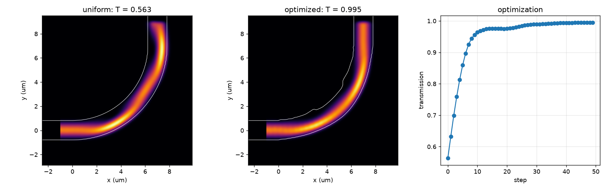

# Inverse design

An air-clad silicon nitride guide on silica, 1.6 µm wide and 0.75 µm thick, bent 90° at 7 µm radius, transmits only
56 % of TE0 at 1.55 µm as TE0 at its uniform width: most of the rest leaves the bend as TE1.
[`examples/guide/inverse_design.py`](https://github.com/Sephiram591/bifrost/blob/main/examples/guide/inverse_design.py)
optimizes the width on each side of its centerline, at 70 stations, for TE0 transmission, by gradient ascent through
the simulation, and raises it to 99.5 %: the bend's loss falls from 2.5 dB to 0.02 dB, and a finer grid confirms it.
Run it on a GPU; on an NVIDIA L40S its 50 steps took 4501 s.



## The bend and its parameters

```python
--8<-- "examples/guide/inverse_design.py:geometry"
```

- **The guide:** 1.6 µm wide and 0.75 µm thick, it guides four modes: TE0 (effective index 1.81), TM0 (1.76), TE1
  (1.63) and TM1 (1.61); TE2 (1.436) is below the silica's 1.444.
- **Where the light goes:** the uniform bend transmits 0.563 of TE0 as TE0 and 0.405 as TE1 (on the 60 nm grid; 0.559
  and 0.414 at 40 nm). Nearly all the light gets through, but 41 % of the input leaves as TE1: the straight guide's mode
  does not match the bend's, which sits toward its outer edge, so the junctions excite both bend modes. Only 3 % is
  lost otherwise.
- **Both ends are fixed:** 1.6 µm wide and centered, so the ports, their straight leads and the monitors in them never
  change. Only the 70 stations in between move, each edge linear from one to the next.
- **The topology is fixed:** every profile has the same 144 vertices, one per station and end on each edge, so the
  device built once, for the uniform bend, takes any profile's vertices with `stack.pack` (see
  [polygon topology](gradients.md#polygon-topology)).
- **Two widths per station,** toward the bend's center and away from it. A single width, symmetric about the
  centerline, helps here: narrowing the bend to 1.2 µm raises the transmission to 0.85 (widening it to 2.0 µm lowers
  it to 0.25). Moving the guide toward the center, so the straight guide's mode lines up with the bend's, helps more:
  0.1, 0.2 and 0.3 µm give 0.82, 0.96 and 0.92. Only two independent edges can express both.

## The simulation

As in [Gradients](gradients.md), with the source 1 µm and both monitors 0.5 µm out in the straight leads, clear of the
moving edges: a monitor on the port itself would see the bend's edges move and change the mode it measures. The silica
is a level on the `WAFER` layer that runs through the bottom of the box, under an air background (see
[Adding a substrate](layer-stacks.md#adding-a-substrate)). The mode reaches into the silica, so the box is 4.8 µm tall
and the source and monitor planes reach 0.5 wavelengths (0.78 µm) above and below the core, where the mode's field has
fallen to about 3 %, still clear of the absorbing layers.

```python
--8<-- "examples/guide/inverse_design.py:simulation"
```

## Objective and optimizer

The objective is the normalized TE0 transmission `|a_out / a_in|²`. Each half-width is a bounded function of an
unbounded parameter, so the optimizer cannot leave 0.25 to 1.25 µm (a guide 0.5 to 2.5 µm wide), and
[optax](https://optax.readthedocs.io)'s Adam (installed with fdtdx) steps on those parameters. `jax.value_and_grad`
runs eagerly: the cell function needs concrete values, so the objective is not wrapped in `jax.jit`.

```python
--8<-- "examples/guide/inverse_design.py:objective"

--8<-- "examples/guide/inverse_design.py:optimize"
```

## Result

```python
--8<-- "examples/guide/inverse_design.py:run"
```

Output (steps 2 to 4, 6 to 9, 11 to 14, 16 to 19, 21 to 29 and 31 to 48 left out):

```text
step  0  T = 0.5634  width 1.60 to 1.60, shift +0.00 to +0.00 um
step  1  T = 0.6326  width 1.59 to 1.60, shift -0.01 to +0.01 um
step  5  T = 0.8591  width 1.53 to 1.60, shift -0.04 to +0.04 um
step 10  T = 0.9636  width 1.47 to 1.61, shift -0.07 to +0.07 um
step 15  T = 0.9760  width 1.44 to 1.65, shift -0.08 to +0.09 um
step 20  T = 0.9756  width 1.45 to 1.68, shift -0.09 to +0.11 um
step 30  T = 0.9894  width 1.54 to 1.74, shift -0.07 to +0.11 um
step 49  T = 0.9950  width 1.52 to 1.75, shift -0.07 to +0.12 um
optimized: width 1.52 to 1.75, shift -0.07 to +0.12 um
transmission at 60 nm: uniform 0.5634, optimized 0.9950
transmission at 40 nm: uniform 0.5586, optimized 0.9934
wall time: 4501 s on NVIDIA L40S
```

- **The design:** the guide stays 1.52 to 1.75 µm wide, and its middle moves by up to 0.12 µm toward the center and
  0.07 µm away from it along the bend. In the figure, the uniform bend's field beats across the guide as TE0 and TE1
  interfere; the optimized bend carries one mode along its outer edge. With no penalty on curvature, the inner edge,
  where little light goes, keeps ripples a few stations long; a design for fabrication would smooth or penalize them.
- **The best step is kept:** here it is the last, but the transmission dips slightly at steps 17 to 19. With a learning
  rate of 0.1 instead of 0.03 it reaches 0.954 at step 3, falls to 0.928 by step 7 and recovers, so `optimize` returns
  the best widths it has seen, not the last. That run ends at a similar transmission (0.9962; 0.9940 at 40 nm), with
  the guide up to 1.96 µm wide and a rougher inner edge.
- **The gain is the device's, not the grid's:** on the 40 nm grid the uniform bend transmits 0.5586 and the optimized
  one 0.9934. The derivatives are those of the discretized simulation (see
  [what the derivatives are](gradients.md#what-the-derivatives-are)), so an optimum is worth checking on a finer grid.
- **The time:** 50 steps, each a forward and a backward solve, then four forward solves for the figure and the check.

## For your own designs

- Choose parameters that can express the improvement: here, two edges rather than one symmetric width.
- Scale the step to the parameters: with 140 of them, Adam's early steps move every edge by about the same amount, so
  a smaller learning rate gives a steadier rise and a smoother profile.
- Bound them through a smooth map (here a sigmoid) instead of clipping, which would stop their gradients at the bounds.
- Keep the ports and the leads that hold the monitors fixed, and keep the number of vertices fixed; for a change of
  topology, rebuild the device with `retopologize` (see [polygon topology](gradients.md#polygon-topology)).
- Keep the best design seen, and check it on a finer grid.
