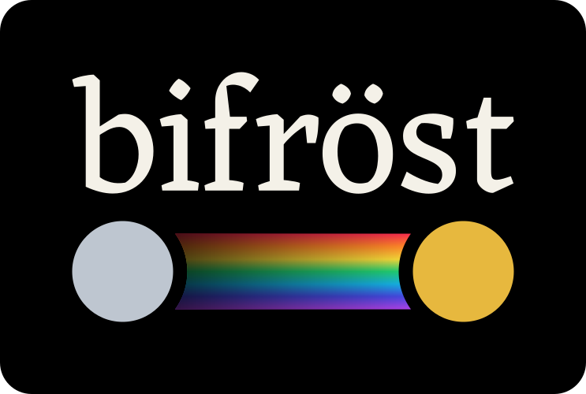

{ width="360" }

# bifrost

The rainbow bridge between your [GDSFactory](https://gdsfactory.github.io/gdsfactory/) pipeline and
[FDTD](https://github.com/ymahlau/fdtdx) simulation.

bifrost turns a gdsfactory component and its layer stack into a differentiable [fdtdx](https://github.com/ymahlau/fdtdx)
simulation, with no GDS export and no re-describing of the geometry in fdtdx primitives, and ships a 3D viewer for
setting up the run and inspecting its fields. A straight silicon waveguide, opened in the viewer (in Jupyter or marimo,
end the cell with `viewer`):

```python
--8<-- "examples/straight_waveguide.py:straight"
```

`bf.StackDevice` is the device the solver sees: the component's polygons, extruded through the layer stack into
permittivity, with ports ready to take sources and monitors. Install with `pip install bifrost-photonics`
([details](installation.md): accelerators, and why upstream gdsfactory must not share the environment).

## Where to go next

<div class="grid cards" markdown>

- **[Run your first simulation](getting-started.md)**

    A 90° waveguide bend from an empty file to a transmission value and a field image.

- **[Explore the live demo](guide/viewer.md#live-demo)**

    The result of that simulation in the viewer, in your browser, with no installation.

- **[Read the user guide](guide/layer-stacks.md)**

    Layer stacks, simulation setup, results, the viewer, gradients and diagnostics.

</div>

bifrost builds on [gdsfactory](https://gdsfactory.github.io/gdsfactory/) for layouts (components, cells, PDKs and
routing: see its documentation for those), on [gdsfactoryx](https://github.com/Sephiram591/gdsfactoryx), the JAX port
of gdsfactory that makes layouts differentiable, and on [fdtdx](https://github.com/ymahlau/fdtdx), the solver.
