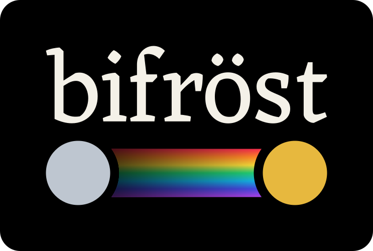

{ width="360" }

# bifrost

The rainbow bridge between your [gdsfactory](https://gdsfactory.github.io/gdsfactory/) pipeline and
[fdtdx](https://github.com/ymahlau/fdtdx) simulation.

bifrost turns a [gdsfactoryx](https://github.com/Sephiram591/gdsfactoryx) (the JAX port
of gdsfactory) component and its layer stack into a differentiable [fdtdx](https://github.com/ymahlau/fdtdx)
simulation. It also ships a 3D viewer for setting up the run and inspecting its fields. Below is an example of a straight silicon waveguide, opened in the viewer:

```python
--8<-- "examples/straight_waveguide.py:straight"
```

`bf.StackDevice` is the helper class where all the magic happens, handling adaptive FDTD meshing and allowing you to create sources/detectors on ports. 

!!! warning "LLM Disclaimer"
    bifrost is largely developed using LLM models from providers including Claude, ChatGPT, and Google. We should always validate any code shipped by "AI". Conveniently, the MEEP FDTD package provides a reference against which to test FDTD simulations build by bifrost and run by FDTDX. [See our convergence testing section](guide/convergence-testing.md) for comparison results between bifrost and MEEP.

## Where to go next

<div class="grid cards" markdown>

- **[Installation](installation.md)**

    How to set up bifrost with [gdsfactoryx](https://github.com/Sephiram591/gdsfactoryx), the JAX port of gdsfactory.

- **[Run your first simulation](getting-started.md)**

    A 90° waveguide bend from an empty file to a transmission value and a field image.

- **[Explore the Widget Demo](live-demo.md)**

    The result of that simulation in an interactive notebook in your browser (or open the standalone [Explorer demo](demo/index.html)), with no installation.

- **[Read the user guide](guide/layer-stacks.md)**

    Layer stacks, simulation setup, convergence testing, results, the viewer, gradients, inverse design and diagnostics.

</div>