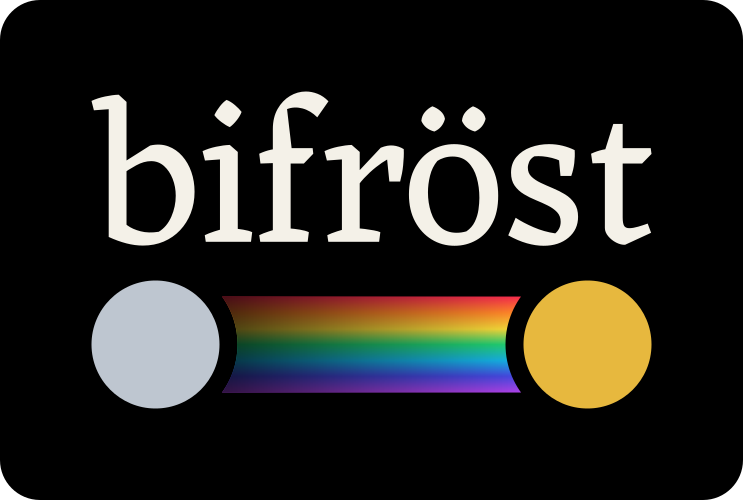

{ width="360" }

# bifrost

The rainbow bridge between your [GDSFactory(X)](https://gdsfactory.github.io/gdsfactory/) pipeline and
[FDTD(X)](https://github.com/ymahlau/fdtdx) simulation.

bifrost turns a gdsfactory component and its layer stack into a differentiable [fdtdx](https://github.com/ymahlau/fdtdx)
simulation, and ships a 3D viewer for setting up the run and inspecting its fields. There is no GDS export and no
re-describing of the geometry with fdtdx primitives. This is a complete example: it builds a straight silicon waveguide
and opens it in the viewer (in a Jupyter or marimo cell, end the cell with `viewer` to display it).

```python
--8<-- "examples/straight_waveguide.py:straight"
```

`bf.StackDevice` is the device the solver sees: the component's polygons, extruded through the layer stack into
permittivity, with ports ready to take sources and monitors. [Installation](installation.md) explains how to get the
packages.

## Where to go next

<div class="grid cards" markdown>

- **[Run your first simulation](getting-started.md)**

    A 90° waveguide bend from an empty file to a transmission value and a field image.

- **[Explore the live demo](guide/viewer.md#live-demo)**

    The result of that simulation in the viewer, in your browser, with no installation.

- **[Read the user guide](guide/layer-stacks.md)**

    Layer stacks, simulation setup, results, the viewer, gradients and diagnostics.

</div>

bifrost builds on [gdsfactory](https://gdsfactory.github.io/gdsfactory/) (components, cells, PDKs and routing: use its
documentation for anything about building a layout), on [gdsfactoryx](https://github.com/Sephiram591/gdsfactoryx) (the JAX
port of gdsfactory that makes layouts differentiable) and on [fdtdx](https://github.com/ymahlau/fdtdx) (the solver).
